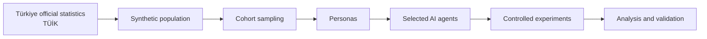
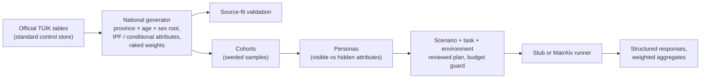
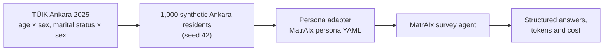

# SocietyTwin — AI-Powered Digital Society Twin for Türkiye

SocietyTwin is an Engineering Design II research project that aims to build a synthetic population of Türkiye from official statistics and use it for controlled, reproducible experiments with AI-powered personas. It is meant for population-level exploration and hypothesis generation, not for predicting individual behaviour.

## Project Status

- The Türkiye-only, large-scale direction comes from the latest instructor feedback; the v2 architecture was drafted in response ([docs/](docs/)).
- **Implemented:** a national pipeline in [`src/societytwin/national/`](src/societytwin/national/) with an API (`/api/v2`) and web UI: one Türkiye-wide generator (province is a dimension), source-fit validation, cohorts, personas, experiments with a stub and a MatrAIx backend, structured weighted results. See [National pipeline](#national-pipeline) and [docs/national-pipeline.md](docs/national-pipeline.md).
- **Data gap:** the team's long-format TÜİK package (reported: 33 datasets, 577 indicators) is not in this repository. Until it is added under `data/raw/tuik_package/`, only the TÜİK-derived Ankara extracts are available, so 1 of 81 provinces has source data. Nothing is filled in for the others.
- The first proof of concept is kept unchanged in [experiments/matraix_simulation/](experiments/matraix_simulation/): a 1,000-resident synthetic Ankara population with two personas run through a MatrAIx survey, including run3 (see [MatrAIx Simulation Experiment](#matraix-simulation-experiment)).
- Architecture decisions still require instructor and team review.

## Why Türkiye

- The instructor asked for a project focused only on Türkiye.
- TÜİK (Turkish Statistical Institute) publishes official population statistics every year down to district level (2025: 86,092,168 residents), plus survey statistics on education, employment, households, and internet use.
- Every synthetic record belongs to one of Türkiye's 81 provinces and uses TÜİK's official categories, so results can be compared with Turkish statistics.

## Core Idea



Related attributes, such as age, education, and employment, are generated together so that they stay consistent with published TÜİK tables. The population is validated against official statistics before it is used.

SocietyTwin is inspired by architectural ideas from large-scale synthetic-persona systems such as MatrAIx, but it is a separate Türkiye-specific academic project.

## Population Records, Personas and AI Agents

| Level | What it is | Uses an LLM? |
|---|---|---|
| **Population record** | A lightweight synthetic record of a fictional resident of Türkiye (for example province, sex, age, education, employment status) | No |
| **Persona** | A richer description constructed from a sampled record | No |
| **Active AI agent** | A selected persona temporarily connected to an LLM for one experiment | Yes |

Population size is not the same as the number of LLM agents. A population can contain 100,000 or more records, but each experiment turns only a small, budget-limited sample into AI agents.

## Proposed MVP

The MVP aims to show one complete path from data to results:

- ingest selected official Türkiye data (TÜİK);
- generate a synthetic population with dependency-aware generation;
- build benchmark populations of 10K and 100K records;
- validate the population statistically against official tables;
- sample cohorts and construct personas;
- run a small, controlled AI experiment;
- analyse results by subgroup;
- provide a basic dashboard / playground;
- make every run reproducible (seeds, configurations, versions).

A 1M-record build is an optional scalability benchmark if time allows; the final required population scale is still an open decision. Stretch goals and the roadmap are in the [architecture report](docs/societytwin-v2-architecture.md#29-mvp).

## National Pipeline



```bash
python3.12 -m venv .venv && .venv/bin/pip install -r requirements-api.lock && .venv/bin/pip install -e . --no-deps
(cd frontend && npm ci)
PYTHONPATH=src .venv/bin/python -m societytwin.national build-controls
PYTHONPATH=src .venv/bin/python -m societytwin.national generate --size 10000 --seed 42
./scripts/dev.sh   # http://127.0.0.1:3000
```

Windows commands, the data workflow (how to add the TÜİK package and map indicators), the dependency model, weights,
validation tolerances, experiment execution and limitations: [docs/national-pipeline.md](docs/national-pipeline.md).

What the current data supports: Ankara 2025 population by age group × sex and marital status × sex (15+), reproduced
exactly by the weighted 10K and 100K builds. Education, labour status, household and settlement type are implemented
in the generator but have no real table loaded; socioeconomic status is not modelled. No model has been called: the
stub backend and MatrAIx's fake transport test the pipeline only, and live provider runs are disabled by default.

## MatrAIx Simulation Experiment

> Historical proof of concept, kept unchanged for reproducibility. In the UI it is **Historical Run3** in the Experiments group, and the dashboard features it as a recorded experiment.

[experiments/matraix_simulation/](experiments/matraix_simulation/) is the first working end-to-end path from TÜİK data to persona-conditioned AI responses. It uses MatrAIx as an external framework (not vendored) and tracks only SocietyTwin-specific code and small fixtures.



| Folder | Contents |
|---|---|
| `src/data_processing/` | Extraction/validation of Ankara TÜİK-derived controls |
| `src/synthetic_population/` | Deterministic Ankara population sampler and marital-status enrichment |
| `src/persona_adapter/` | Converts a synthetic resident to a MatrAIx persona YAML |
| `src/runtime/` | Smoke runner (no API calls) and two-persona A/B runner |
| `processed/`, `synthetic/`, `personas/` | Small reproducibility fixtures |

Quick start (Windows, Python 3.12, MatrAIx checked out next to this repository as `../MatrAIx-Persona-8B`):

```powershell
py -3.12 -m venv .venv
.\.venv\Scripts\python -m pip install -r experiments\matraix_simulation\requirements.txt
$env:MATRAIX_ROOT = (Resolve-Path ..\MatrAIx-Persona-8B).Path
.\.venv\Scripts\python -m pip install -e "$env:MATRAIX_ROOT" -e "$env:MATRAIX_ROOT\packages\playground"

# No API calls: verify persona/task wiring
.\.venv\Scripts\python experiments\matraix_simulation\src\runtime\run_matraix_smoke.py --matraix-root "$env:MATRAIX_ROOT"

# Prepare the A/B run (no calls); add --execute for exactly two live calls
.\.venv\Scripts\python experiments\matraix_simulation\src\runtime\run_matraix_ab.py --matraix-root "$env:MATRAIX_ROOT" --model <provider/model>
```

Live runs need a provider key in `experiments/matraix_simulation/.env` (copy `.env.example`; the file is git-ignored). Full setup, model selection, and verification notes: [experiments/matraix_simulation/README.md](experiments/matraix_simulation/README.md).

Current limitations of this experiment:

- Only the two fixed test personas (`ANK2025_000001`, `ANK2025_000183`) can be run.
- Marital status is sampled by sex only, not jointly with age; sex is not shown to the model.
- The survey is MatrAIx's example product-feedback task, not a Türkiye-specific instrument.
- Two trials are a pipeline proof-of-concept; they do not establish causality or behavioural realism.

## Research Workbench

The local web UI and API. The main pages (Dashboard, Population, Cohorts, Personas, New Experiment, Experiments, Results, Validation, Data Sources, Settings) serve the national pipeline through `/api/v2`; the Dashboard is the Türkiye-wide overview (summary, province coverage map, population snapshot, pipeline status). The original Ankara workbench (fixture builds, two fixture personas, recorded MatrAIx runs including run3) is kept under **Historical Run3** through `/api/v1`, as an experiment detail and reproducibility page. Everything works offline; MatrAIx-backed runs need an external runtime; live provider runs are disabled by default.

```bash
python3.12 -m venv .venv && .venv/bin/pip install -r requirements-api.lock && .venv/bin/pip install -e . --no-deps
(cd frontend && npm ci)
./scripts/dev.sh   # http://127.0.0.1:3000
```

Setup, configuration, what is implemented versus gated, and known limits: [docs/research-workbench.md](docs/research-workbench.md).

## Technology

In use: Python 3.12, FastAPI, Pydantic, PyArrow/Parquet, SQLite (registry), Next.js, TypeScript, Recharts,
pytest, Vitest, Playwright, GitHub Actions. Proposed but not adopted yet: NumPy/pandas, DuckDB, PostgreSQL, Docker.

Details and justifications: [docs/architecture.md](docs/architecture.md).

## Documentation

| Document | What it covers |
|---|---|
| [v2 architecture report](docs/societytwin-v2-architecture.md) | Full design, decisions, MVP, roadmap, open questions |
| [v2.1 technical architecture](docs/societytwin-v2.1-architecture.md) | Proposed revision of v2 (reproducibility, validation, behaviour engines) |
| [MatrAIx findings and roadmap](docs/matraix-findings-and-implementation-roadmap.md) | MatrAIx benchmark findings and implementation plan |
| [Architecture reference](docs/architecture.md) | Modules, interfaces, technology |
| [Project overview](docs/project-overview.md) | Problem, research questions, scope |
| [Persona schema](docs/persona-schema.md) | Attributes, data sources, dependencies |
| [Data strategy](docs/data-strategy.md) | TÜİK and other sources, access, licences |
| [Validation strategy](docs/validation-strategy.md) | How the population and experiments are validated |
| [Experiment system](docs/experiment-system.md) | Playground workflow and experiment types |
| [Ethics and limitations](docs/ethics-and-limitations.md) | Privacy, bias, and limits |
| [Methodology](docs/methodology.md) | Research methodology |
| [Sources](docs/sources.md) | Literature, reference systems, and data sources |
| [Migration plan](docs/migration-plan.md) | Changes from the earlier v1 design ([archived](docs/archive/architecture-v1-demographic.md)) |
| [Team responsibilities](docs/team-responsibilities.md) and [research integration](docs/research-integration.md) | Research roles and how they fit together |
| [Data handling](data/README.md) | Rules for the data folder |
| [National pipeline](docs/national-pipeline.md) | Türkiye-wide generator, data workflow, validation, cohorts, personas, experiments, API, limitations |
| [Research workbench](docs/research-workbench.md) | Local UI and API setup, configuration, the historical Ankara workbench, gated execution |
| [MatrAIx simulation experiment](experiments/matraix_simulation/README.md) | Setup and running of the Ankara proof-of-concept experiment |
| [Experiment results](experiments/matraix_simulation/EXPERIMENT_RESULTS.md) | Results of the two-persona A/B run (gpt-4o) |

## Team

Current research-phase responsibilities:

| Team member | Responsibility |
|---|---|
| Bejan | Project Manager / System Architect |
| Sam | Environment + Scenario/Task (previously Literature Research) |
| Pakhlavon | Technical Architecture / Technologies |
| Azra | Existing Systems / Similar Projects |
| Koray | Data + Population + Simulation Research |

Ownership of SocietyTwin v2 implementation modules has not yet been assigned.

## Data, Privacy and Limitations

- The MVP is designed to use official aggregate statistics, primarily from TÜİK, as its main data foundation. No real-person records or personally identifiable information are used.
- Synthetic personas are fictional and identified by codes, not names. SocietyTwin does not reconstruct or represent real Turkish citizens.
- SocietyTwin is for population-level research only; its results are not guaranteed predictions of real human behaviour.
- The sensitive categories defined in Türkiye's data protection law (KVKK Article 6), such as ethnic origin, religion, political opinion, and health, are excluded from the persona schema.
- No raw dataset or experiment result is committed to this repository. The only committed data are small derived fixtures for the MatrAIx experiment (processed Ankara TÜİK controls, a 1,000-record synthetic Ankara population, and two persona YAMLs) and clearly artificial test fixtures under `tests/fixtures/`; control tables, generated populations and run outputs are git-ignored.
- Source-fit validation (does the population reproduce the official tables?) is separate from behavioural validation (do AI responses resemble people?). Passing the first says nothing about the second.

More detail: [ethics and limitations](docs/ethics-and-limitations.md) and [data/README.md](data/README.md).
