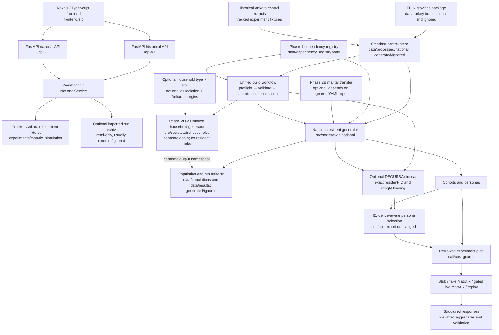

# Current System Handover

**Snapshot:** 2026-10-20 (Prompts 1–6; Europe/Istanbul)
**Repository:** `pakhlavonKh/AI-powered-digital-society-twin`
**Feature branch:** `feature/ankara-population-realism`
**Purpose:** factual subsystem handover through Prompt 5, Prompt 6 compatibility/publication review, and the agreed team integration workflow. Source changes remain staged/unstaged/untracked locally; no population implementation commit has been made. Readiness is conditional, not release approval.

## Status vocabulary

- **IMPLEMENTED** means code and tests exist in this repository. It does not mean the system predicts real behaviour.
- **EXPERIMENTAL** means an opt-in or research path exists but is not part of the default resident/API workflow or is not independently validated.
- **RESEARCH ONLY** means findings or design notes exist, but no executable feature is implemented.
- **NOT IMPLEMENTED** means the capability must not be inferred from a schema, research report, or future proposal.

## Architecture at a glance



The frontend is not changed by the population feature in this branch. The household generator is a separate Python
entry point: it is not connected to either API, the UI, the resident schema, or resident records.

## Implemented system

### Original UI, backend, and historical MatrAIx path — **IMPLEMENTED**

- `frontend/` is the Next.js/TypeScript workbench. Its API client and generated OpenAPI types target the local FastAPI
  service. Current national pages use `/api/v2`; historical pages remain under `/historical` and use `/api/v1`.
- `src/societytwin/api/app.py` assembles the historical routes and loopback-only mutation guard. `src/societytwin/api/v2.py`
  defines national request/response routes. Business logic is in `src/societytwin/workbench.py` and
  `src/societytwin/national/service.py`; persistent workbench registry and run state are local SQLite/files under the
  ignored `data/results/` tree.
- The historical experiment in `experiments/matraix_simulation/` contains SocietyTwin's Ankara extraction,
  deterministic sampler, persona adapter, and smoke/A-B runners. MatrAIx itself is external and is not vendored.
  Its inputs include the tracked small Ankara CSV/persona fixtures; recorded run directories are ignored and may need
  to be supplied separately. The historical route reads imported runs without modifying them.
- The national runner in `src/societytwin/national/runner.py` supports deterministic `stub`, external MatrAIx
  `fake` transport, gated MatrAIx `live` transport, and cached `replay`. A reviewed plan, call cap, explicit
  confirmation, and idempotency key guard a run. Live execution is disabled by default and has not been verified
  against a paid model provider.

### TÜİK ingestion and resident population — **IMPLEMENTED**

- `src/societytwin/national/sources.py` reads the historical Ankara extracts and, when supplied, the team's TÜİK
  province package. `data/tuik_package_mapping.yaml` maps package indicators to control/context records. Long-format
  values are accounted for; wide files are checked against, not double-counted with, the long files.
- The package is **not** in this feature branch. It is on `origin/data-turkey` under `tuik_province_data/` and is
  intentionally ignored in code checkouts. `data/README.md` has copy-only setup commands; do not merge that branch
  into a code branch.
- `src/societytwin/national/controls.py` and `store.py` normalize and persist the control store under
  `data/processed/national/` (generated and ignored). The Ankara fixtures are available from a normal clone; with no
  province package, coverage is limited to the tracked historical Ankara extracts.
- `src/societytwin/national/generator.py` creates resident records rooted in province × age-band × sex controls,
  draws supported attributes, constructs weights, and records source-fit and constraint validation. The usual
  all-province build requires the separate data package.
- `src/societytwin/national/cohorts.py`, `personas.py`, `experiments.py`, `runner.py`, and `results.py` implement
  the `/api/v2` sampling-to-results path. `src/societytwin/national/validation.py` checks statistical fit and
  constraints; it is not held-out or behavioural validation.

### Phase 1 dependency registry — **IMPLEMENTED**

- `data/dependency_registry.yaml` is typed and validated by `src/societytwin/national/dependencies.py`.
  `src/societytwin/national/model.py` adapts its declarations to the original national sampler. The
  `national-v1` compatibility gate retains the prior source order, random streams, schema and calibration behavior;
  configuration cannot turn on new execution semantics.
- `SOCIETYTWIN_DEPENDENCY_REGISTRY` optionally selects an internal registry path. Missing/invalid registries fail
  explicitly. The default registry is repository data; an installed standalone wheel without a checkout data
  directory is not a supported packaging mode.
- The generator still leaves unsupported labour and person-level household attributes unavailable. Registry metadata
  does not create evidence or resident-household links.

### Phase 2B broad-age marital transfer — **EXPERIMENTAL**

- `src/societytwin/national/marital.py` optionally transfers national sex × broad-age marital percentages to the
  observed Ankara 2025 age/sex and marital/sex controls using IPF. It is disabled in the checked-in registry and is
  constrained to Ankara, 2025, and calibrated generation.
- The source is a manually transcribed national percentage table, not Ankara counts or observed five-year
  age-specific marital data. Nearest-tenth rounding and positive scenarios for printed young-widowhood zeros are
  explicit sensitivity assumptions, not verified TÜİK rounding rules. This is not independent validation.
- Running this option requires `data/raw/national_marital_seed_2025.yaml`, which is deliberately ignored and not
  published because the source's reuse terms are unresolved. The acquisition and verification procedure is below.

### Phase 2D-2 unlinked households — **EXPERIMENTAL**

- `src/societytwin/households/` validates household-unit evidence, allocates size-class representatives with
  deterministic Hamilton allocation, applies household expansion weights, validates, and writes separate Parquet
  artifacts. Its on-disk registry at `data/household_registry.yaml` is disabled; `--enable-households` is explicit
  request-local opt-in. `docs/unlinked-households.md` describes the schema and limits.
- It consumes only household counts by size from Ankara's 2025 NIP table. It does not generate residents, families,
  links, roles, types, member ages, exact sizes for `10+`, or institutional populations. Its outputs are not a
  substitute for the resident population. This statement describes the default size-only schema; the separate
  type × size strategy below is now implemented.
- Running it requires `data/raw/ankara_household_size_2025.csv`, which is deliberately ignored and not published
  because the source's reuse terms are unresolved. The acquisition and verification procedure is below.

### Phase 2D-3 household type × size — **EXPERIMENTAL, IMPLEMENTED**

- `households/type_size*.py` and `data/household_type_size_registry.yaml` implement the explicit
  `national_household_type_size_seed_v1` strategy. It is disabled by default and does not change size-only artifacts.
- Existing IPF fits the national seven-size-band × four-type joint to both observed Ankara 2025 household margins.
  Semantic support excludes impossible type/size cells. National coarse log-odds are retained by construction.
- The named `exchangeable_within_observed_7plus_v1` assumption lifts the 7+ proportions to 7, 8, 9, 10+; those finer
  type relationships are not observed. `TypeSizeStore` uses distinct `hht-...` identity/schema with two additional
  categorical fields and provenance; exact 10+ size remains null. No resident links or member attributes exist.

### Optional resident sidecars — **EXPERIMENTAL, IMPLEMENTED**

- `src/societytwin/enrichment/` and `data/resident_extension_registry.yaml` implement
  `registry_conditional_categorical_v1`. Only `degurba_class` is executable, conditional on province/sex observed
  counts with assumed independence from other traits within sex. This is not district/address information.
- One ID-aligned row per resident is stored under `ext-...` with typed values/statuses/provenance. Core columns,
  design weights and population weights remain unchanged. Parent registry fingerprint, complete resident content,
  checksums, statuses, categories and deterministic assignment replay are checked by readers.
- Generation is off by default. Missing evidence fails unless the explicit unavailable policy applies; unsupported,
  not-reported, outside-universe and published-unknown statuses remain distinct. Optional margins fluctuate without
  reweighting and are checked diagnostically against conditional sampling error.

### Unified build workflow — **IMPLEMENTED; optional models remain EXPERIMENTAL**

- `src/societytwin/build/` coordinates existing resident, sidecar and separate household components. The typed
  `ankara-build-config-1` accepts only Ankara/2025 in this bounded workflow; examples live in `data/build_configs/`.
  No new algorithm or person–household linkage is introduced. Inputs are preflighted and checksum-verified.
- Output is a `build-<sha256>` bundle with `build-manifest.json`, `validation.json` and separate component roots.
  Identity binds config, selected registries/evidence, control hashes, code-content fingerprint and runtime versions.
  Readers inspect inventory/checksums, child identities and sidecar alignment. Existing-bundle reuse changes no bytes.
- Staging and publication use a same-filesystem directory rename; ordinary errors publish no partial bundle.
  Abrupt termination can leave hidden staging debris. Network filesystem durability and concurrent publication
  races were not fault-injected. Timestamps/timings in legacy resident manifests remain operational metadata.

### Evidence-aware persona selection/export — **IMPLEMENTED; opt-in evidence is EXPERIMENTAL**

- `national/persona_selection.py` provides `FieldSelection` and `PersonaResolver`. Required/optional selections must
  be unique, allowlisted and within a strict configurable attribute count. Household types/sizes and unsupported
  new attributes cannot be selected. Missing required values fail; optional missingness is explicit.
- The resolver validates a selected sidecar once, joins exact IDs and retains source/status/assumption metadata.
  DEGURBA's synthetic/independence limitation is included in model-visible text. It does not alter cohort membership,
  draw order, inclusion probabilities or analysis weights. Default persona builders/exports remain identical.
- `national/experiments.py` supports mutually exclusive legacy `visible_fields` and optional `field_selection`;
  planning/execution use the same resolver and reviewed prompt hashes. `national/personas.py` includes selection
  metadata only on opt-in exports. MatrAIx itself is still an external, separately configured runtime.
- **Public-contract review outstanding:** the shared `ExperimentDefinition` HTTP request model exposes the new optional
  field and `FieldSelection` schema; the checked-in frontend OpenAPI snapshot lacks them. Original `ui_design`
  matches the snapshot in the same interpreter. Existing routes/default requests are unchanged, but this additive
  schema exposure needs explicit Bejan/Pakhlavon API review and Sam's client review. No snapshot was rewritten and
  no contract failure was hidden. See “Public interfaces and compatibility expectations” below.

## Evidence limitations

### Education and resident attributes

- Education is available in the provincial package as sex × attainment totals, not province × age × sex × attainment.
  `src/societytwin/national/generator.py` infers the age relationship with IPF and applies documented minimum
  completion-age structural zeros. It is a modelled association, not an observed joint.
- Marital status is ordinarily sourced by sex for age 15+; age-specific associations are not observed for the
  Ankara baseline. In the 81-province pipeline, each supported attribute is only as granular as its published table.
- Person-level labour status, household size/type, income, SES and district are not supported by the loaded
  provincial evidence. Labour rates and household margins/context do not imply person-level distributions.
- Missing source cells remain unavailable/not reported as appropriate; they are not silently treated as zero.

### Households

- The Phase 2D-2 table covers private households and reports household counts in classes 1–9 and `10+`. The open tail
  has a lower bound only. Household weights represent households, never residents.
- No linked household membership, exact `10+` sizes, roster evidence, or coherent joint
  household/person weights are implemented. Household-margin fit by construction does not establish realistic
  families. Separate modelled household types are implemented only in the optional type × size artifact, not
  as resident attributes or as an observed Ankara joint.

## Data setup and portability

### Environment and team package

From a fresh clone on Windows, use Python 3.12 and Node.js 22 or later:

```powershell
py -3.12 -m venv .venv
.\.venv\Scripts\python -m pip install -r requirements-api.lock
.\.venv\Scripts\python -m pip install -e . --no-deps
Push-Location frontend
npm ci
Pop-Location
```

The complete current input inventory, all five raw feature-input hashes, package commit pin, source authorities,
normalization contracts, loader checks and verified Windows control-build workaround are in
[population-data-setup.md](population-data-setup.md). Node/frontend setup is an existing application prerequisite;
frontend checks were not rerun or modified in this review.

The optional 71-file provincial package is shared separately on `data-turkey`; it is not part of this branch:

```powershell
git fetch origin data-turkey
New-Item -ItemType Directory -Force data\raw\tuik_package | Out-Null
git archive --format=tar -o tuik_package.tar origin/data-turkey tuik_province_data
tar -x -f tuik_package.tar -C data\raw\tuik_package --strip-components=1
Remove-Item tuik_package.tar
(Get-ChildItem data\raw\tuik_package -File | Measure-Object).Count  # expected: 71
$env:PYTHONPATH = "src"
# On Windows use the verified function-level control build in population-data-setup.md.
# The existing national CLI imports Unix-only resource and fails before argument parsing.
```

The function-level setup writes control data under ignored `data/processed/national/`; it does not generate a population. For
confidence in the real province package, `.\.venv\Scripts\python -m pytest -m tuik_package -q` uses that local package.
Without the package, run the artificial-fixture tests; available real source coverage is limited to tracked Ankara
extracts.

### Two local-only feature inputs and reuse status

This historical subsection retains the original size/marital acquisition details. The subsystem now requires **five**
raw optional inputs in total: add the national household joint, Ankara household type extract and DEGURBA derivative
listed with verified hashes in [the full data guide](population-data-setup.md#required-feature-inputs-authority-hashes-and-acquisition).
Package/derived controls, sidecars and generated bundles also remain ignored. Exact transcribed byte regeneration
from a new official download is not fully automated; do not represent a source/schema recipe as byte portability.

The current inputs were inspected on 2026-10-19 and their SHA-256 digests match the values pinned in the registries:

| Local-only input | Source and content | Pinned SHA-256 | Reuse status |
|---|---|---|---|
| `data/raw/ankara_household_size_2025.csv` | TÜİK Nüfus İstatistikleri Portalı, “Hanehalkı Büyüklüğüne Göre Hanehalkı Sayısı,” Ankara, 2025; 10 observed size classes | `1aed9e3fb1b65ab6ab4a880247b5b4b662cd980b6dfee5cedd3d904dedc2471b` | **OPEN DECISION**; the public portal and attribution are identified, but permission to redistribute its tabulation is not established |
| `data/raw/national_marital_seed_2025.yaml` | TÜİK, *Youth in Statistics 2025*, Publication 4821, table 1.9, printed p.14 / PDF p.36; 16 national percentages | `55dbc9752f4e19617cd9803dced10811a1efdb7e0cdcc906adac878141fb796d` | **OPEN DECISION**; no explicit open-data licence verified |

Both paths are ignored by `.gitignore`, as are all files under `data/raw/` and data-format files under `data/`. This
policy matches `data/README.md` and the open decisions in `docs/data-strategy.md`; **do not add ignore exceptions or
commit either file until TÜİK's applicable reuse permission is confirmed**. Do not commit the source PDF, portal
exports, cached HTML, or archived research evidence either.

To reproduce the household input without copying Bejan's local file:

1. Open the official table at <https://nip.tuik.gov.tr/?value=HanehalkiBuyukluguneGoreHs>, choose the **Tablo**
   tab, set **Düzey Seçiniz** to **İl**, and select **ANKARA**. The official page's `tableDuzey` and `tableIl`
   controls load `HanehalkiBuyukluguneGoreHs`; the table header defines classes `1` through `9` and `10+`.
2. Read the 2025 Ankara row and transcribe the ten counts into the `households` column of a UTF-8 CSV with exact
   header `province_code,reference_year,household_size_class,households`; use province code `06`, year `2025`,
   classes in `1` … `9`, `10+` order, and plain integer counts (remove the portal's thousands separators). Do not
   use the Türkiye row, a mean, a residual, or another year's row. Preserve the portal's aggregate counts; do not
   derive any household members.
3. Save as `data/raw/ankara_household_size_2025.csv` in UTF-8 without BOM, CRLF line endings, and a final newline.
   Check 10 unique classes, the source province/year, positive integer counts, total `1,987,216`, and the pinned hash
   below. The normal loader also enforces these conditions. A source revision or formatting difference must be
   investigated against the official table; do not edit the registry hash merely to bypass the check.

To reproduce the optional marital input:

1. Obtain the official *Youth in Statistics 2025* publication from the TÜİK URL recorded in
   `data/manifest.yaml` and `data/dependency_registry.yaml` (also listed in
   [national-pipeline.md §16](national-pipeline.md#16-optional-ankara-broad-age-marital-transfer)). Inspect table
   1.9, printed page 14 / PDF page 36. The source is a national percentage table; it is not an Ankara count table.
2. Recreate the YAML transcription at `data/raw/national_marital_seed_2025.yaml` using the complete field contract
   enforced by `MaritalEvidence` in `src/societytwin/national/marital.py`: `schema_version`, `source_version`,
   `title`, `publication_number`, `publication_date`, `isbn`, `table`, `printed_page`, `pdf_page`, `url`,
   `methodology_url`, `reference_year`, `geography`, `unit`, `denominator`, `precision_pp`, `categories`,
   `rounding_rule_confirmed`, `zero_interpretation`, `acquisition`, `reuse`, and `rows`. Use the exact publication
   metadata recorded in `data/manifest.yaml`; category order `never_married, married, divorced, widowed`; and
   exactly four rows for sex `male`/`female` × age bands `15-24`/`25+`. Transcribe the four published percentages
   in that order exactly; ensure each row sums to 100. Keep the recorded statement that rounding is unconfirmed and
   retain the cited source and methodology URLs.
3. Save as UTF-8 YAML without BOM, LF line endings, and a final newline at the pinned path; compare the
   transcription's SHA-256 below. The hash is for the YAML transcription bytes, **not** for the downloaded
   publication. Do not invent/reconstruct missing precision, change the rounded zero to an observation, or alter
   the pinned checksum without a reviewed source revision.

For both inputs on Windows:

```powershell
Get-FileHash data\raw\ankara_household_size_2025.csv -Algorithm SHA256
Get-FileHash data\raw\national_marital_seed_2025.yaml -Algorithm SHA256
$env:PYTHONPATH = "src"
.\.venv\Scripts\python -c "from pathlib import Path; from societytwin.households.registry import load_registry, REPO_ROOT; from societytwin.households.evidence import load_evidence; print('household total:', load_evidence(load_registry(), REPO_ROOT).total)"
.\.venv\Scripts\python -c "from societytwin.national.dependencies import load_registry; from societytwin.national.marital import load_evidence; print('marital source:', load_evidence(load_registry().marital_strategy).source_version)"
```

These read-only loader checks verify exact checksums and schema without generating a population. The household hash is
also pinned in `data/household_registry.yaml`; the marital transcription hash is pinned in both
`data/manifest.yaml` and `data/dependency_registry.yaml`.

The official marital table was re-inspected through the TÜİK PDF text view during this handover. All 16 local
transcribed cells match table 1.9 and each published row passes its displayed-total check. The direct publication
download returned HTTP 403 in the archived source-gate attempt and again from this Windows shell; the original PDF
binary is not preserved in the worktree. The cited publication remains the source of truth, and its web-readable
text was checked against the local transcription. No 403 response or partial download is accepted as the data source.

### Attribution and legal handling

- Household source attribution: **Türkiye İstatistik Kurumu (TÜİK), Nüfus İstatistikleri Portalı**, “Hanehalkı
  Büyüklüğüne Göre Hanehalkı Sayısı,” Ankara, 2025,
  <https://nip.tuik.gov.tr/?value=HanehalkiBuyukluguneGoreHs>. The related TÜİK site legal notice is
  <https://www.tuik.gov.tr/Kurumsal/Yasal_Uyari>.
- Marital source attribution: **TÜİK**, *Youth in Statistics 2025*, Publication 4821, table 1.9,
  “Cinsiyet ve yasal medeni duruma göre nüfus oranı,” printed p.14 / PDF p.36; official publication URL and metadata
  URL are recorded in `data/manifest.yaml` and in the local transcription's metadata.
- `docs/data-strategy.md` records TÜİK portal reuse as **OPEN DECISION**; the NIP legal notice is not evidence of an
  open licence for these tables. Until rights are confirmed, acquire from the official portal/publication for local
  research use only under its applicable terms, preserve attribution, and do not redistribute the transcriptions,
  source files, or copies. Ask TÜİK for clarification if the intended use or redistribution is not covered. No access
  control or download restriction is to be bypassed.

## Tests and verified outcomes

Prompt 6 reran all backend test directories explicitly, including `tests/build`, which default pytest recursion
otherwise excludes because its directory name is `build`. Result: **408 PASS, 7 FAIL, 7 SKIP** in 183.94 seconds.
Population/registry/marital/persona/cohort tests: 157 pass; households: 73 pass; enrichment: 37 pass;
unified build: 35 pass. These four subsystem groups have zero failures. API/legacy groups contain the recorded failures.

```powershell
$env:PYTHONPATH = 'src'
$env:PYTHONDONTWRITEBYTECODE = '1'
python -B -m pytest tests/national tests/households tests/enrichment tests/build tests/api tests/regression tests/integration tests/unit -q -p no:cacheprovider --basetemp=data/results/my-private-compatibility-tests --junitxml=data/results/my-private-compatibility-tests.xml
```

Choose a new private `--basetemp`/XML path on each run; pytest may clear an existing basetemp. Artificial-fixture
tests do not require the raw package, while marked local/package regressions and optional real-data cases use it
when available. Tests block non-loopback sockets and clear provider credentials/live-execution settings.

Classification is explicit; failures are not deselected:

- **PASS:** six regenerated default resident snapshots (1,000/10,000 × seeds 42/43/44), including columns,
  weights, provenance, 18 cohort draws and 120 default persona representations, match the established snapshots.
  Four fresh default size-only household artifacts match the Phase 2D-2 baseline byte-for-byte.
- **KNOWN BASELINE FAILURE (6):** two Windows symlink privilege failures; two digest tests expecting
  `line_ending_equivalent` instead of exact `match`; one historical snapshot/preflight hash consistency failure;
  one Windows default-encoding CSV mutation makes a fixture unreadable. Prompt 5 reproduced all six with HEAD
  source and identical fixture bytes. Original `ui_design` is still clean at that same HEAD.
- **FAIL / NEW REGRESSION relative to baseline (1):**
  `tests/api/test_api_contract.py::test_openapi_snapshot_matches_frontend_client`. The current opt-in model makes
  a deliberate additive schema change; its checked-in snapshot is stale relative to the current model, but that
  does not approve public exposure. Review is outstanding; no automatic snapshot/type generation was performed.
- **SKIP (7):** five external MatrAIx checkout/interpreter tests, one missing historical run3 archive check,
  one `fcntl`-specific worker-lock test. No live provider/runtime verification is claimed.
- **KNOWN BASELINE PLATFORM FAILURE:** national CLI help fails on Windows due to `resource` in both worktrees.
  Unified, household and enrichment help pass. Function-level control setup is verified in a fresh private output.

### Prompt 5 quality, reproducibility and performance

The retained 64 builds cover 32 cases (1,000/10,000 × seeds 42/43 × eight default/optional combinations), each in
two independent roots/processes. All 32 pairs reproduce substantive identities, resident data, optional sidecar/
household files, cohort hashes and persona exports. Maximum independently summed demographic cell residual was
4.97e-11, all requested calibration margins converged, and structural violations were zero. Education checks
verify sex-conditional shares scaled to resident totals; its official absolute denominators differ by approximately
2.06%/2.26%. Household targets represent 1,987,216 private households, not 5,910,320 resident persons.

DEGURBA diagnostics remain sampled expectations (maximum |z| 1.780, within four SE). National association
preservation and exact margins are implementation checks, not held-out realism. Type × size builds retain seven
singleton cells at n=1,000 and two at n=10,000. 10,000 records do not eliminate rare-cell uncertainty.

Prompt 5 measured default resident generation medians 0.113 s at 1,000 and 0.611 s at 10,000. Total default build
medians were 16.37/10.69 s, affected by fixed control parsing and shared-host/cache effects. Peak build process
working set was approximately 368/377 MiB for default; the fully optional 10,000 case reached 418 MiB. Bundle
sizes were approximately 0.615/0.659 MiB default and 0.844 MiB fully optional at 10,000. These are actual local
measurements, not isolated cold-cache benchmarks or million-record scalability promises.

Atomic-publication failure guards and six disposable corruption/alignment probes pass. Operational timestamps/
timings may differ across fresh roots; whole-directory or cross-version byte identity is not promised. No new
statistical experiment or provider call was needed for this handover.

### Public interfaces and compatibility expectations

| Interface | Current contract / integration expectation |
|---|---|
| `/api/v1`, `/historical` | Original historical readers/adapter remain; keep legacy fixtures/statuses distinct |
| `/api/v2` populations/cohorts/samples/default personas | Same paths, request fields and default representations; no household/sidecar generation endpoint |
| `/api/v2/experiments` | Uses shared `ExperimentDefinition`; optional `persona.field_selection` now appears in schema; explicit contract/snapshot review required |
| Python generation and stores | Existing resident schema/IDs/defaults preserved; registry compatibility must not activate unsupported semantics |
| `python -m societytwin.build run --config ...` / `inspect <bundle>` | Implemented local Ankara workflow; requires prepared control directory and selected raw sources |
| `python -m societytwin.households --enable-households ... [--type-size]` | Separate household units/output; opt-in does not imply membership |
| `python -m societytwin.enrichment --enable-enrichment ...` | Separate resident-ID sidecar; explicit exact population and sidecar roots |
| Persona exports | Default envelope/dimensions unchanged; selection metadata and evidence-labelled custom dimensions only on opt-in |

Do not silently change published versions, seed streams, weight units, IDs, missingness semantics or registry
source pins. Review `national/service.py`, `experiments.py`, `personas.py`, `config.py` and API models jointly
before integration. Source/schema snapshots must be reviewed together with Sam's generated client, never simply
rewritten to make the test pass. Frontend/typecheck/browser flows were not executed in Prompt 6.

### Earlier ignored evidence reports

These reports and research outputs are local, git-ignored evidence, not release artifacts:

- `data/results/phase2a/report.md` and `validation.json` record source acquisition, manual web extracts, the 2025
  household HTML/XLSX cross-check, and the limitation that the original Youth 2025 PDF binary was not archived.
- `data/results/phase2b/report.md` and `source-gate-validation.json` document the initial stop on treating printed
  young-widowed `0.0` as a known zero. The subsequent code implements a clearly assumed, optional rounding
  sensitivity policy; the unresolved rounding interpretation remains a limitation, not new observed evidence.
- `data/results/phase2d2/report.md` records earlier artificial-test results (44 household tests, 142 national tests,
  and 34 API tests with one security test deselected due Windows symlink privileges) and disposable real-data
  household checks at sizes 1,000 and 10,000. Those prior runs reported exact weighted size margins, repeatability,
  and unchanged resident snapshots. Prompt 6 freshly compared the four default household baselines described above.
- `data/results/registry-phase1/implementation-report.md` and `comparison.json` hold the pre-registry snapshot
  comparison and earlier compatibility test results.

Additional ignored reports: `phase2d3/report.md`, `phase2c-enrichment/report.md`, `unified-build/report.md`,
`persona-enrichment/report.md`, `final-validation/report.md`, and `final-readiness/report.md`. These reports are not
delivered by a code clone. Prompt 6 generated only private compatibility/setup outputs and did not overwrite
earlier research artifacts or rerun the 64-build performance matrix. The tracked handover carries the summary.

## Git and output policy

- Expected branch for this work: `feature/ankara-population-realism`; expected remote:
  `https://github.com/pakhlavonKh/AI-powered-digital-society-twin.git`.
- The separate `ui_design` worktree is owned by Sam and must not be modified from this handover. Both worktrees
  currently point to `dd1fd0cd37250e96d64d8e0a56b9cd24a6385b93`; `ui_design` is an ancestor (indeed equal to current
  feature HEAD). Its original UI/application work is already included. Only the local uncommitted population work
  distinguishes this checkout; pushing its present HEAD alone would publish none of that work.
- Keep downloaded inputs, controls, populations, household artifacts, experiments and run output ignored. Do not
  merge `data-turkey` into this branch. Review staged paths and file sizes before any publication.
- No branch was created, committed, pushed or merged in this review. Existing staging boundaries are unchanged.

### Publication content and gates

The existing index is incomplete for the finished subsystem. A later authorized publication must include reviewed
working versions of the registry/generator/household changes **and** all new `src/societytwin/build/`,
`src/societytwin/enrichment/`, `households/type_size*.py`, `national/persona_selection.py`, their tests, both new
registry metadata files, `data/build_configs/`, and current documentation. The `.gitignore` exceptions for
`src/societytwin/build` and `tests/build` are necessary: these are source/test directories, not package build outputs.

Keep `.venv-persona/`, the accidental `try and optional models\uF022` diff-stat capture, raw inputs, control stores,
generated results and archives out of commits. The unusual file is 1,929 bytes of ANSI-coloured staged diff-stat
text, not executable source; it was inspected and preserved, not deleted. The current ignore rules do not protect
`.venv-persona/`, so never use a blanket `git add .`. An explicit proposed file list is saved locally in
`data/results/final-readiness/publication-files.json`; it is a review artifact, not staging authorization.

Publication-candidate working/index content was checked for high-confidence credential patterns and large files;
no candidate secret match or candidate file over 1 MiB was found. This is a scoped scan, not a complete secret audit
of external data, environments or all Git history. Raw-data rights remain unresolved; do not publish those files.

Existing CI runs on PRs and pushes to `main`, not arbitrary feature-branch pushes. The backend command excludes
local/package/external-runtime markers and default recursion misses `tests/build`; Pakhlavon must explicitly add
workflow coverage or review collection settings. Backend snapshot failure and the frontend typed-client comparison
remain real gates. No frontend file, CI configuration, snapshot or application algorithm was changed here.

### Team branches, common base and merge sequence

1. **Current verified common base B:** `dd1fd0cd37250e96d64d8e0a56b9cd24a6385b93` (`ui_design` and local
   `origin/ui_design`). This includes the UI, APIs and national pipeline. Local cached `origin/main` is
   `760e79fd5f70f217b39e2664034959278a5c1aad`, an ancestor 17 commits behind B. Local `main` is also behind its
   remote-tracking ref. No fetch was performed: verify server refs in the later authorized publication session.
2. **Bejan:** retain `feature/ankara-population-realism`, resolve/approve the API exposure decision and review the
   complete publication file list. Only a later authorized, tested and published population commit becomes shared
   base **P**. P does not yet have a SHA; do not invent one or tell teammates this uncommitted filesystem is on GitHub.
3. After P is published and its SHA shared, create **Koray `feature/data-enrichment`**, **Sam
   `feature/ui-enhancements`**, **Pakhlavon `feature/system-integration`**, and **`integration/society-twin`** from P.
   Koray supplies acquisition/provenance and permitted setup utilities, Sam handles UI/client work, Pakhlavon owns
   integration. Their branches should not start from the older local `main` or the raw-data branch. Bejan continues
   future population work on his existing feature branch from the agreed reviewed tip.
4. Pakhlavon reviews each contribution with its domain owner and integrates it into `integration/society-twin`.
   Run explicit population/build/API regressions, clean-checkout data setup, and frontend/type/browser/end-to-end
   checks. Configure external MatrAIx only for approved zero-cost integration checks; paid calls are not implied.
5. Merge into `main` only after Bejan approves the complete integration diff, including the original 17 UI/history
   commits absent from cached `origin/main`, and all required compatibility gates pass. Do not merge `data-turkey`.
   Starting integration from P already includes B; do not duplicate/cherry-pick its UI changes unnecessarily.

| Files / responsibility | Single owner for subsequent edits | Required reviewers / coordination |
|---|---|---|
| Population generators, dependency/household/extension registries, build and sidecar internals, persona selection and their tests | Bejan | Koray for source contracts; Pakhlavon for integration |
| `data/manifest.yaml`, `data/tuik_package_mapping.yaml`, acquisition provenance and data setup | Koray | Bejan approves model-affecting source revisions |
| `frontend/**`, generated OpenAPI/client artifacts | Sam | Pakhlavon approves API contract; Bejan approves exposure policy |
| `national/service.py`, `experiments.py`, `personas.py`, `config.py`, API routes and runner integration | Pakhlavon | Bejan reviews population/persona semantics; Sam reviews client impact |
| `pyproject.toml`, locks, `.github/workflows/workbench.yml`, `.gitignore` | Pakhlavon | Other owners request changes rather than editing concurrently |
| `docs/CURRENT_SYSTEM_HANDOVER.md` and integration approval record | Bejan | Koray, Sam and Pakhlavon supply verified updates |

These are proposed coordination boundaries after the shared snapshot; they do not rewrite authorship or discard
Bejan's existing changes in shared files. Teammate branching prerequisites are: published complete P, known SHA,
API contract decision, explicit data-permission/setup status, and agreed file ownership. Full optional-data
portability may remain an explicitly documented development limitation, but it blocks claims of reproducible
real-data integration until resolved.

**Readiness:** controlled local development is supported. **NO-GO to push the present incomplete/uncommitted state
as a completed feature**, and **NO-GO to merge into main**. A code-only development branch can be published after
the complete reviewed snapshot is authorized, excluded files are kept out, and the API review/failing-test status
is explicit; it must remain a development contribution, not release approval. This review grants no commit/push
authorization.

## Not implemented / research only

- Linked person-household rosters, household member composition, and resident-household joint weights: **NOT IMPLEMENTED**.
- National broad-age marital transfer as the default resident model: **NOT IMPLEMENTED**; the isolated transfer is
  **EXPERIMENTAL** and off by default.
- 81-province household records, household types in the Phase 2D-2 output, exact membership for `10+`, and an
  institutional-household allocation: **NOT IMPLEMENTED**.
- Held-out source validation and evidence that persona/model responses match real people: **NOT IMPLEMENTED**.
- Phase 2D-3 household type transfer: **EXPERIMENTAL, IMPLEMENTED** as described above; higher-order household/member
  relationships and additional persona attributes remain **RESEARCH ONLY / NOT IMPLEMENTED**.
- Live provider execution remains gated and unverified. Historical two-persona summaries and broader research claims
  in experiment reports are not population-level evidence.
