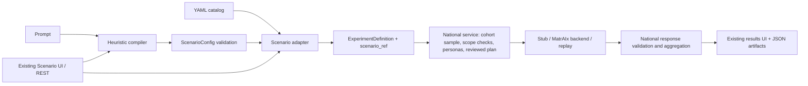

# Scenario Engine execution audit — 2026-10-28

**Verdict: NEEDS FIXES — working standalone, integration blocked.**

The existing source-checkout UI and API run locally. A built-in scenario completed
the full offline workflow. Required-attribute enforcement, policy-text consistency,
heuristic fare extraction and installed-package resources still need work.
During the evaluation, no implementation code was repaired, committed, pushed or merged.

## Publication scope and evidence availability

This documentation-only publication audits `origin/scenario-engine` at exact commit
`22ec61deffa443d897a76632e553beed004d1cda` on 2026-10-28. The report branch
was based on that same remote commit after a fresh fetch. Findings apply to this
revision; no newer revision is claimed to have been tested.

All localhost URLs, process IDs, run IDs and service availability below describe
the audit session, not a hosted deployment or a guarantee that services remain
running. Every named JSON/XML file, screenshot, script, log, environment and
runtime artifact below is **local evidence retained by the auditor and not
included in this documentation-only commit**. They are not repository links.
The original report and evidence remain preserved locally. No credentials,
generated datasets, binaries, virtual environments or logs are published.

Source paths refer to the repository at the audited revision; from this document,
the repository root is `../../`. See the existing
[Scenario Engine documentation](../scenario-engine.md) for repository guidance.
Machine-specific paths below are explicitly local audit-environment references.
Reproduction requires an equivalent Python 3.12 dependency environment, the
repository's synthetic fixtures and, for browser checks, a compatible Node setup.
The restart scripts and full HTTP driver mentioned below are local-only helpers,
not commands available in a fresh clone.

## Local audit-session URLs

- Scenario controls: http://127.0.0.1:3010/experiments/new?pop=pop-TR-2025-n1000-s42-c4f78c10
- Correctly configured built-in template run: http://127.0.0.1:3010/results/run_78508f1d9263
- API explorer: http://127.0.0.1:8010/docs
- OpenAPI: http://127.0.0.1:8010/openapi.json

Chrome was opened to the application. Both services were HTTP-verified and left
running: backend listener **Python PID 16004, port 8010**; frontend listener
**Node PID 8924, port 3010**. Launcher PIDs are 41032 and 45176 respectively.
Both bind only to 127.0.0.1. Frontend API proxy health also returned HTTP 200.

## A. Git and preservation

Remote `scenario-engine`: **22ec61deffa443d897a76632e553beed004d1cda**.
Fetch and a final remote check confirmed this tip. It contains exactly one commit
after `6d8c6f9`: `22ec61d`, “resolve P0/P1 audit defects, scope enforcement, and
MatrAIx runtime integration.” Changes add scope/reference checks, parameter
templating, question-type guards, overwrite protection and runtime adjustments.
Against `origin/main` (`f45b279`), there are 29 changed files, 4,730 insertions
and 233 deletions, including the compiler, UI, APIs and tests.

Isolated detached worktree:
`<local-audit-worktree>`.
The previous `Digital Society Twin/scenario-audit` contained untracked audit work;
it was preserved. No existing checkout was switched, reset, cleaned or stashed.
The Population Engine worktree remains clean on
`feature/population-hybrid-households` at `6164bda3e0a225763ad32607e373db03fed9945a`.

Scenario-worktree tracked status and `git diff --check` are clean. Frontend
dependencies/cache and one UI-generated catalog YAML are Git-ignored runtime
artifacts. The latter is `prompt_ankara_transportation_535609.yaml`, created by
the actual UI's save operation. Original scenario definitions were not edited.
Audit scripts, state, logs and this report live in the sibling
`scenario-exploration-20261028` directory, outside implementation source.

## B. Actual architecture

Paths below are relative to the isolated Scenario Engine worktree.

| Component / source | Invocation and inputs | Outputs / independence |
|---|---|---|
| Definitions: `experiments/policy_scenarios/scenarios/*.yaml` | Load transport or electricity YAML | Two built-in hypothetical Ankara scenarios; no model required |
| Models: `src/scenarios/schema.py` | `ScenarioConfig.model_validate(data)` | Validated policy, location, filters and questionnaire; library use |
| Loader: `src/scenarios/loader.py` | `load_scenario(path)` | Typed scenario or parse/validation error; YAML/JSON |
| Catalog/save/adapter: `src/scenarios/adapter.py` | `get_scenario`, `list_available_scenarios`, `save_custom_scenario`, `scenario_to_experiment_definition` | Catalog, persisted YAML or one selected-question experiment; needs directories/DST models |
| Compiler: `src/scenarios/compiler.py` | `compile_scenario_from_prompt(text)` | Heuristic scenario with UUID-derived ID; optional explicitly enabled paid compiler was not used |
| Eligibility utility: `src/scenarios/eligibility.py` | `evaluate_resident(record, filters)`, `filter_population` | eligible/excluded/cannot_evaluate diagnostics; independent library utility |
| Prompt utility: `src/scenarios/prompt_renderer.py` | `render_scenario_prompt` with scenario/persona/context | Prompt envelope; library utility |
| Response utility: `src/scenarios/response_validator.py` | `validate_agent_response(response, scenario)` | Structured envelope and invalid-choice diagnostics; supports multi-select validation |
| Production planning: `src/societytwin/national/experiments.py`, `service.py` | Definition + population/cohort -> plan | Sample, personas, prompts, estimates, blockers and scenario_ref |
| Execution: `src/societytwin/national/runner.py`, `service.py` | Reviewed plan hash + confirmation | Stub synchronous run, queued MatrAIx run or cached replay |
| Agent bridge: `src/societytwin/agents/matraix_runtime.py`, `matraix_batch.py` | External interpreter, MatrAIx checkout, task/persona/job files | Actual agent trials with fake or live transport; external runtime needed |
| REST: `src/societytwin/api/v2.py` | `/api/v2/scenarios`, experiments, plans, runs | JSON; request schemas validated, many response handlers return untyped dictionaries |
| UI: `frontend/src/app/experiments/new/page.tsx` | Prompt, template/question, settings and wizard | Compile/save, cohort creation, planning, running and result navigation |
| Results: `frontend/src/app/results/[id]/page.tsx`, `national/results.py` | Run ID, grouping settings | Weighted distributions, subgroup comparisons, responses, provenance and replay |
| CLI | National pipeline CLI exists; no `scenarios/__main__.py` | No dedicated Scenario Engine CLI; use API or library functions |
| Tests/fixtures | `tests/test_scenarios`, `tests/national/test_scenario_pipeline.py`, `tests/fixtures/*` | Synthetic unit/API/pipeline checks; no official-data downloads needed |

The standalone scenario eligibility/prompt/response utilities are **not** the
functions used by the national runtime. Production uses `scenario_ref` scope
checks, national persona/prompt rendering and national response validation. This
distinction explains why standalone eligibility can reject missing income while
the execution planner accepts the converted definition.



Implemented execution supports **one single-choice question per experiment**.
Multiple questionnaire questions can be selected individually. Multiple-choice
execution is deliberately rejected; its library response validator is not a
multi-select execution backend. There is no new standalone scenario simulator,
dedicated `/scenarios` frontend route, household linker or graph sampler.

## C. UI verification

The dedicated scenario controls are integrated into the existing **New Experiment**
screen, not a separate application. Chrome verified HTTP 200, rendered controls,
template selectors, question selectors, advanced fields, a completed run, result
charts and the Experiments/Results/Cohorts/Personas screens. No browser page errors
were observed. Screenshots: `scenario-ui.png`, `scenario-advanced.png`,
`wizard-stale-text.png`, `template-results.png`, `ui-stub-results.png`.

The default execution selector is `matraix:fake`, which still requires a configured
external runtime. For this Windows deployment select **Pipeline Test (No AI /
Offline)**. Its placeholder results are explicitly labelled by the application.

## D. Runtime and launch

Python requirement: **3.12** (`>=3.12,<3.13`). A separate `.venv` was created
here, with a `.pth` referencing already installed dependency files from the
existing `.venv-persona`; source imports use the isolated checkout explicitly.
No Python dependency upgrade was made. Cached setuptools/wheel from the old audit
environment built the wheel without changing that checkout.

Backend: FastAPI/Uvicorn factory. State is local SQLite plus files; no external
database. Existing fixture directories provide artificial controls/data, never
official estimates. Backend live execution and live scenario compilation are both
explicitly disabled; provider-key environment entries are removed for startup.

Frontend: Next.js 16.3.8 / React 19.3.0, existing lockfile. `npm ci --offline
--ignore-scripts --no-audit --no-fund` installed 289 cached packages. Node 20.13.1
satisfies Next's >=20.9 requirement, but several pinned development/test packages
require newer Node (some >=22.22.2 or >=24.15). No manifests were changed.

Actual server commands:

```powershell
# Backend: environment setup is captured in start-backend.ps1.
<audit-root>\.venv\Scripts\python.exe -B -m uvicorn --factory societytwin.api.app:app_factory --host 127.0.0.1 --port 8010
# Frontend, from the isolated frontend directory:
$env:SOCIETYTWIN_API_ORIGIN = 'http://127.0.0.1:8010'
node node_modules/next/dist/bin/next dev --hostname 127.0.0.1 --port 3010
```

The supplied restart scripts set all fixture/state paths and start hidden
background processes with log files. **Only use these if the servers have stopped**:

```powershell
$audit = '<local-audit-root>'
# Terminal 1:
powershell.exe -NoProfile -ExecutionPolicy Bypass -File "$audit\start-backend.ps1"
# Terminal 2:
powershell.exe -NoProfile -ExecutionPolicy Bypass -File "$audit\start-frontend.ps1"
```

The execution-policy override is process-local; no machine policy was changed.
Logs are `backend.*.log` and `frontend.*.log`. Python environment, controls,
populations, registry and run outputs are kept beneath this audit directory.

## E. Demonstrations and exact evidence

`api-evidence.json` records every HTTP method, path, request body, status and
returned payload. `browser-workflow.json` records actual browser POST operations
and wizard fields. These contain generated synthetic records only.

| Operation | Invocation / input | Observed output |
|---|---|---|
| Health/OpenAPI | GET `/api/v1/health`, `/openapi.json`, `/docs` | HTTP 200 |
| Discovery | GET `/api/v2/scenarios` | Two original templates; three after UI saves its compiled example |
| Selection/loading | GET `/api/v2/scenarios/transport_fare_001` | Scenario 1.0.0, two single-choice questions |
| Validation | POST `/scenarios` with `{}`; short from-prompt input | HTTP 422; no separate validation endpoint exists |
| Unknown IDs | GET nonexistent scenario or question | HTTP 404, including `question_not_found` for bad question |
| Save protection | POST altered definition with existing scenario ID | HTTP 409 conflict; original YAML preserved |
| Fixture population | POST `/controls/build`; POST `/populations` with size 1000, seed 42 | Validated artificial population `pop-TR-2025-n1000-s42-c4f78c10`; records in Adana/Ankara, not real residents |
| Targeting | POST `/cohorts/preview`, create Ankara adult cohort | Eligible counts and source-bound cohort |
| Conversion | GET `/scenarios/transport_fare_001/experiment-definition?cohort_id=cht_684cf48aa355&question_id=q1_usage_change&seed=7` | 21.00 -> 25.20 TL, +20%, concessions, reference date and scenario_ref |
| Plan/run | POST experiment; POST plan; POST run with reviewed hash and `confirm:true`, sample 5, stub/fake | `run_78508f1d9263`, completed, 5 valid responses, 0 provider calls |
| Results | GET `/runs/{id}`, `/responses`, `/aggregate`, `/aggregate?group_by=sex` | HTTP 200; manifest preserves scenario ID/version/question/target scope |
| Scope violation | Same Ankara scenario with Adana cohort | Non-executable plan, `scenario_province_mismatch`; run HTTP 409 `plan_blocked` |
| Replay | POST `/runs/run_78508f1d9263/replay`, idempotency key `scenario-audit-replay-001` | HTTP 202, completed, 0 provider calls |
| Browser one-click | Pipeline Test, sample 10, Ankara, prompt “Ankara public transport fares rise by 30% from 21 TL” | Completed `run_e2d937b04b4f`, 10 valid placeholders, 0 provider calls, actual dashboard; **wrong extracted baseline, see below** |

The original template is a **hypothetical** intervention using an August 2024
baseline. It is not a claim about current fares. Stub outcomes are deterministic
pipeline placeholders, not AI judgments or policy predictions. For the five-person
template run the choices counted 1 maintain, 1 reduce, 0 walk, 3 private car/taxi,
0 unsure; these counts have no behavioral validity.

### Reproduced policy defects

1. **Required attributes lost:** add `income` to the template's required list.
   Standalone `evaluate_resident` returns `cannot_evaluate` with missing income.
   The adapter omits that list from scenario_ref and declares no unenforced filter;
   the real HTTP experiment plan returns `executable=true`, no blockers.
2. **Wizard stale text:** loading the template then changing numeric parameters to
   new fare 27.3 / increase 30 leaves description and question at 20% / 25.20 TL.
   This was reproduced in Chrome; the incorrect form was not executed.
3. **Compiler default overrides intended baseline:** the browser's prompt includes
   “from 21 TL” but the parser only recognizes a from/to pair, then falls back to
   hard-coded 40 TL for a transit percentage. The resulting run used **40 -> 52 TL**.
   Its description still repeats the user's “from 21 TL” input. Do not treat this
   successful run as a faithful execution of the requested policy.
4. Documented API `category`/`province` catalog filters are not implemented: GET
   `/api/v2/scenarios?category=energy&province=34` returned every catalog entry.

Minimum fixes are to propagate/enforce required attributes fail-closed, retain
parameter bindings or re-render text when the wizard edits numbers, and reject or
explicitly expose missing fare evidence instead of silently inserting a baseline.
No such fixes were made during this audit.

## F. Tests and package behavior

Run from the isolated checkout, using this audit directory's Python:

```powershell
$python = '..\scenario-exploration-20261028\.venv\Scripts\python.exe'
$temp = Join-Path $env:TEMP ('scenario-tests-' + [guid]::NewGuid().ToString('N'))
& $python -B -m pytest -c pyproject.toml tests/test_scenarios tests/national/test_scenario_pipeline.py -q -p no:cacheprovider --basetemp=$temp
# Full suite: same command without the two test paths, with a fresh temporary root.
```

- Focused schema/compiler/loader/eligibility/adapter/response/API/pipeline tests:
  **48 passed** (previous audit: 35).
- Full repository: **418 passed, 6 failed, 13 skipped** (previous: 405/6/13).
- All six failures reproduced on an unchanged `origin/main` archive: two Windows
  symlink-privilege failures; two match-vs-line-ending-equivalent assertions; one
  historical-run consistency assertion; one changed-source encoding/build lookup.
  They are not new Scenario Engine failures. Evidence: `full-tests.xml`,
  `baseline-tests.xml`; focused results in `focused-tests.xml`.
- TypeScript: `node node_modules/typescript/bin/tsc --noEmit --incremental false`
  **passed**.
- Vitest: `node node_modules/vitest/vitest.mjs run` **could not start**: missing
  Rolldown native/WASI binding, alongside unsupported Node engine warnings. No
  frontend unit-test pass count is claimed. A compatible Node/runtime dependency
  installation is needed; deleting/changing the lockfile was not attempted.
- Actual browser interactions and screenshots are separate from those unit tests.

An actual wheel was built from a disposable source copy with cached
setuptools 84.2.1/wheel 0.48.0 and installed with `pip --no-index --no-deps
--target ...`. Source was excluded from the isolated import path. `scenarios`
and `societytwin` import from the installed wheel, but app startup fails with
`RegistryError`: missing `data/dependency_registry.yaml`. The wheel contains
neither that registry nor the built-in scenario YAML files; default catalog
discovery outside the checkout is empty. Supplying explicit source catalog paths
works, which is not a self-contained installed deployment. Evidence:
`package-smoke.json`, wheel build/install logs and original startup traceback.
The minimum packaging fix is to ship/resolve required resources, including the
import-time dependency registry and scenario examples, independently of checkout
layout. No production resources were copied in to disguise the failure.

## G. Previous audit defects

| Prior issue | Status | Behavioral evidence |
|---|---|---|
| Geographic targeting bypass | **FIXED** for tested province/age scope | Adana plan blocked and execution HTTP 409; Ankara completes |
| Version/question/target provenance lost | **PARTIALLY FIXED** | ID/version/question/province/age survive plan/manifest; required-attribute list is lost |
| Fare changes leave stale text | **PARTIALLY FIXED** | Revalidating/rendering ScenarioConfig gives 27.30 TL; advanced wizard still keeps old text; prompt compiler also inserts an unsupported baseline |
| Concession context dropped | **FIXED** in tested template path | Date/category/concessions appear in converted parameters and actual MatrAIx user prompt |
| Invalid question silently falls back | **FIXED** | Actual API returns 404 question_not_found |
| Multiple-choice silently converted | **FIXED** by explicit rejection | Actual adapter raises UnsupportedQuestionTypeError; execution itself remains unsupported |
| Installed-package API fails | **PARTIALLY FIXED** | scenarios package now shipped/importable; API still fails on missing registry and catalog resources |
| Actual MatrAIx unverified | **PARTIALLY FIXED** | Two real fake-transport agent trials succeeded; Windows UI runtime bridge remains unconfigured; paid/live execution deliberately not tested |

## H. Population integration

Not ready for unrestricted advanced Population Engine integration. The source
workflow consumes existing weighted resident populations/cohorts and does not
need household linking to demonstrate scenarios. It does not consume the new
experimental membership sidecar or establish household roles/incomes. Do not
turn unknown attributes into eligible values. Required-attribute loss must be
fixed before using optional attributes as targeting requirements.

The standalone eligibility utility also aliases `sex` and `gender`; future
integration must preserve the Population Engine's administrative-sex/gender
distinction. Student targeting is a heuristic age proxy (18–26), not observed
student status. The Scenario Engine branch does not include the Population
feature branch's latest reviewed projection, so its exact contracts must not be
assumed to have transferred automatically. No population source was changed.

## I. Actual MatrAIx execution levels

1. Scenario loading/conversion: real library/API, verified.
2. Stub execution: real national pipeline with deterministic placeholder answers,
   verified through HTTP and browser.
3. Actual agents with fake transport: the branch's **unchanged**
   `src/societytwin/agents/matraix_batch.py` ran two `PersonaJsonSurvey` trials
   under the existing Ubuntu WSL checkout
   `/home/lenovobejan/MatrAIx-Persona-8B`, commit
   `3633d8dab149a9482a71b024418a49ae828cc941`, Python 3.14.4. Both trials were
   successful; `provider_calls=0`. They use MatrAIx's
   `DeterministicSurveyJsonClient`, not inference. Captured prompts/artifacts and
   answers are in `matraix-offline/`; `batch_report.json` proves the trial results.
4. Integrated Windows UI -> external agent process: not configured. The backend
   expects a usable local interpreter/checkout; no WSL bridge was introduced.
5. Live provider execution: intentionally skipped, no API keys or paid calls.

The offline batch used credential-free `env -i`, closed proxies, fake transport,
and `python -I -B`. Job paths were explicitly converted to WSL paths in the audit
job, not by changing the production runner. `prepare-matraix-offline.py` records
how actual scenario task/personas were materialized from the HTTP demo.

## J. Practical walkthrough

1. Open the New Experiment URL above; the artificial population is already built.
2. Choose **Pipeline Test (No AI / Offline)** in Execution Engine.
3. Open **Show Advanced**. Select **Ankara Public Transportation Fare Increase**,
   choose `q1_usage_change` or `q2_policy_support`, and click **Load Template**.
4. Review the baseline 21, proposed 25.2, increase 20, date and concessions.
   These are hypothetical fixture settings. Re-select a small sample if loading
   the template reset it. Use the generated Ankara adult cohort.
5. Inspect the Task, Environment, Cohort and Model steps. For numeric parameter
   edits, manually review/update BOTH the description and question: automatic
   re-rendering in this form is currently broken. Do not blindly trust NL parsing.
6. Go to Review, create/review the plan and prompts, confirm, then run. Keep the
   backend as Pipeline Test; the default zero-cost agent mode needs external setup.
7. Results shows weighted option bars, subgroup controls, structured responses,
   reproducibility/limitations and cache replay. Small groups may be suppressed
   at the default minimum of 10; that is not missing simulation output.
8. Experiments lists definitions/runs; Results lists completed runs; Cohorts and
   Personas expose the input cohort and selected resident profiles. All demo data
   are artificial, and stub charts are not behavioral findings.

For terminal/API inspection:

```powershell
Invoke-RestMethod http://127.0.0.1:8010/api/v2/scenarios
Invoke-RestMethod http://127.0.0.1:8010/api/v2/scenarios/transport_fare_001
Invoke-RestMethod http://127.0.0.1:8010/api/v2/runs/run_78508f1d9263
Invoke-RestMethod http://127.0.0.1:8010/api/v2/runs/run_78508f1d9263/aggregate
```

`api-exploration.py` contains the complete reproducible request sequence, with
small synthetic fixture generation and no paid paths. Run manifests/responses
are under `state/national_runs/<run_id>/`; `api-evidence.json` contains exact
request inputs/outputs. The generated prompt scenario remains available in the
catalog as evidence of the compiler's wrong-baseline behavior.

## K. Final assessment

**NEEDS FIXES — working standalone, integration blocked.**
There is a real integrated UI, a functioning API and a demonstrable full offline
source-checkout workflow. Actual fake-transport MatrAIx agents also ran separately.
It is not just a collection of passing unit tests. However, the required-attribute
gap and inconsistent policy parameters/text make automatic advanced population
integration unsafe, and wheel deployment is not self-contained. These need
explicit fixes and regression evidence before integration review can pass.

During the evaluation, no merge, push, commit, population modification, paid call or silent source repair
was performed. Servers were left running for direct exploration.

## Publication checkpoint and reproduction details

A fresh Git inspection found no tracked modifications in any registered worktree.
The evaluated detached checkout's source and tests match the audited commit.
Ignored generated scenario YAMLs (including a second saved `4f2a12` example),
frontend dependencies/cache and `next-env.d.ts` remain local. The older audit
checkout contains an untracked temporary test and diagnostic script; these were
preserved and excluded. Other worktrees contain unrelated untracked audit files
and environments, including an ignored `.env`; none were read into this report,
staged, reverted or deleted. This is a verification of present Git state, not a
claim that Git records every transient action during the earlier session.

Additional reproduction details for remaining blockers:

- **Required attributes:** load the transport template, add `income` to its
  `target_population.required_attributes`, evaluate a resident lacking income
  with `evaluate_resident`, then convert using
  `scenario_to_experiment_definition`. Submit the definition through the existing
  experiment/plan endpoints with an otherwise eligible Ankara cohort. Compare
  the missing-income standalone diagnostic with the executable plan. Preserve
  required attributes in the adapter and enforce availability before execution.
- **Stale text:** in New Experiment / Show Advanced, load the transport template;
  edit proposed fare to 27.3 and increase to 30. Compare the unchanged description
  and question against the parameter fields before running. Re-render dependent
  text or block review until inconsistent text is resolved.
- **Wrong baseline:** compile `Ankara public transport fares rise by 30% from
  21 TL` using the existing prompt endpoint or UI. Inspect old/new fare fields:
  the observed output was 40/52 rather than 21/27.3. Preserve explicit baseline
  evidence and reject or expose any unresolved assumptions.
- **Catalog filtering:** GET `/api/v2/scenarios?category=energy&province=34`;
  compare the full returned catalog with the requested constraints. Implement
  documented filters or remove the unsupported contract.
- **Installed deployment:** build the wheel from this revision, install into an
  isolated environment with declared dependencies, leave the source checkout,
  and invoke `societytwin.api.app:app_factory`. Inspect the missing dependency
  registry error; separately inspect default catalog discovery. Bundle and
  resolve registry/catalog resources without relying on checkout-relative paths.
- **Runtime limits:** select the default MatrAIx fake backend without configuring
  an external interpreter/checkout; inspect runtime prerequisites. Document a
  supported Windows/WSL integration or configure a supported native runtime.
  Separately rerun frontend tests on the lockfile's supported Node versions.

The main comparison used `f45b279`, the main revision available during execution;
it is historical audit context, not a statement about today's main tip. Only the
six failing tests were rerun on that main archive; a new full main-suite run is
not claimed. Test counts and evidence summaries above are preserved findings;
raw evidence is unavailable to readers of this branch alone.