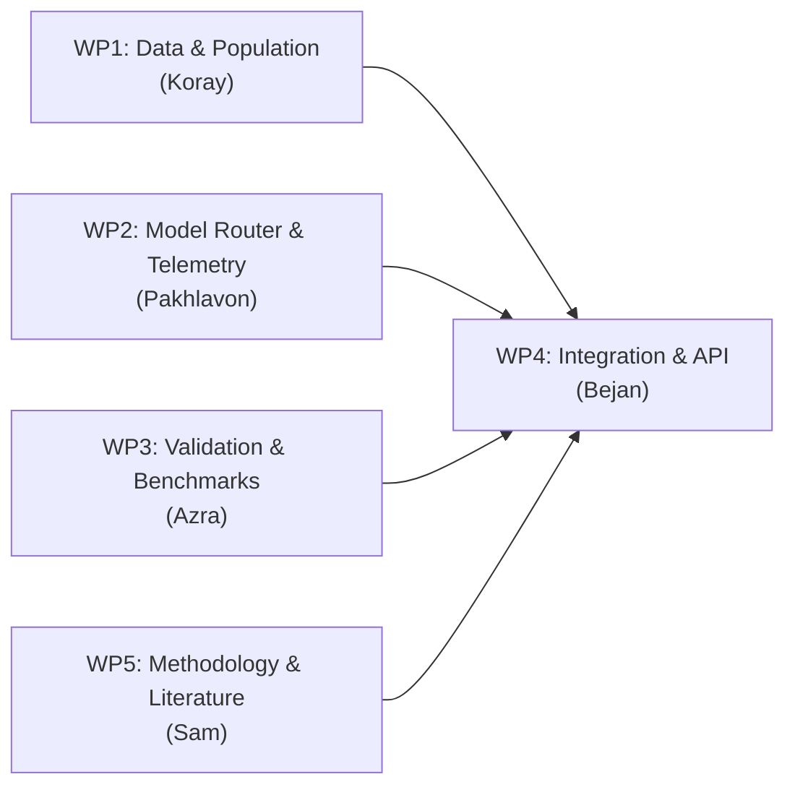

# MatrAIx Benchmark Findings & SocietyTwin Implementation Roadmap

**Project:** Engineering Design II — AI-Powered Digital Society Twin for Türkiye  
**Status:** Complete Sprint 0 Report & Implementation Plan  
**Target:** Team Review (Bejan, Sam, Pakhlavon, Azra, Koray) & Project Architecture

---

## 1. Executive Summary

We successfully executed a local benchmark of `MatrAIx-Persona-8B` (external checkout, not part of this repository), proved its survey execution runtime on a Windows laptop, implemented a policy scenario for **Ankara Public Transportation Fare Increase ($40 \text{ TL} \rightarrow 48 \text{ TL}$ / $+20\%$)**, and ran it across both generic MatrAIx personas and Ankara-grounded demographic personas.

### Key Takeaways
1. **MatrAIx is validated:** Its Jinja2 persona prompt template and strict JSON survey protocol produce coherent, reasoned behavioral adaptations without needing Docker containers.
2. **MatrAIx contains heavy bloat:** The repository carries 1,290 global dimensions, complex browser/OS desktop agents, and Docker harnesses that SocietyTwin does not need. Its survey engine is fundamentally ~150 lines of Python.
3. **Architectural Choice:** We firmly adopt **Option A (Reuse Modular Lego Pieces)**: we extract the prompt template, survey protocol, and telemetry into our clean repository ([`AI-powered-digital-society-twin`](../README.md)) and build our population layer natively from official TÜİK census data.

---

## 2. Empirical Results: Ankara Transportation Fare Experiment

### 2.1 Experiment Setup
- **Baseline Fare:** 40 TL per ride
- **Policy Fare (+20%):** 48 TL per ride
- **Scope:** EGO Municipal Buses, Ankaray, and Ankara Metro Lines (M1–M4)
- **Question Asked:** *"After this fare increase, what would you most likely do?"*
- **Sample Cohort:** 6 synthetic citizens (1 baseline generic MatrAIx persona + 5 Ankara-grounded demographic profiles).

### 2.2 Individual Persona Decisions

| Persona ID | Name & Profile | Chosen Decision | Perceived Budget Impact | Behavioral Rationale |
| :--- | :--- | :--- | :---: | :--- |
| **`ankara_01`** | **Elif Yılmaz**<br>• 22yo Student, Çankaya<br>• Low income, no car<br>• High price sensitivity | **Switch some trips to walking** | **HIGH** | *"As a student on a tight budget in Çankaya, paying 48 TL per ride adds up. I will walk for trips under 2 km and save transit for essential rides."* |
| **`ankara_05`** | **Burak Arslan**<br>• 20yo METU Student, Batıkent<br>• Low income, no car<br>• Commutes via M1 Metro | **Reduce optional trips** | **HIGH** | *"My university commute from Batıkent is too far to walk or bike, so I must pay the higher fare for classes, but I will eliminate all optional weekend trips."* |
| **`ankara_04`** | **Ahmet Öztürk**<br>• 68yo Pensioner, Mamak<br>• Fixed pension, no car<br>• High price sensitivity | **Switch some trips to walking** | **HIGH** | *"On my current income, a 20% fare hike significantly squeezes my daily allowance. I will walk shorter distances whenever possible."* |
| **`ankara_02`** | **Murat Kaya**<br>• 42yo Civil Servant, Keçiören<br>• Middle income, has car<br>• Commutes to Kızılay | **Continue using public transport** | **MEDIUM** | *"Although 48 TL is noticeably higher, driving in Kızılay traffic and paying parking is far more expensive. I will continue using public transport."* |
| **`ankara_03`** | **Selin Demir**<br>• 31yo Tech Worker, Ayrancı<br>• High income, owns car<br>• Low price sensitivity | **Continue using public transport** | **LOW** | *"An 8 TL increase has negligible impact on my monthly budget compared to parking and fuel costs; transit remains fast and convenient."* |
| **`0042`** | **Casey Brooks**<br>• MatrAIx Generic Baseline<br>• Teacher, family of 5+ | **Continue using public transport** | **MEDIUM** | *"Public transit remains my primary everyday transportation method."* |

### 2.3 Aggregated Society-Level Metrics

```text
Modal Shift Distribution:
  • continue using public transport :  3 / 6 (50.0%)  [██████████]
  • switch some trips to walking    :  2 / 6 (33.3%)  [██████]
  • reduce optional trips           :  1 / 6 (16.7%)  [███]

Perceived Budget Burden:
  • High Impact   : 3 / 6 (50.0%) -> Students & Pensioners
  • Medium Impact : 2 / 6 (33.3%) -> Civil Servants & General Commuters
  • Low Impact    : 1 / 6 (16.7%) -> High-Income Professionals
```

**Key Finding:** Geographic location and income interact significantly. Students in central walkable districts (Çankaya) switch trips to walking, while students in peripheral districts (Batıkent) cannot walk and are forced to eliminate leisure/discretionary trips.

---

## 3. Core Architectural Reasoning: Why Option A Wins

We evaluated three integration paths:

| Architectural Option | Meaning | Pros | Cons | Verdict |
| :--- | :--- | :--- | :--- | :---: |
| **Option A: Reuse Parts (Lego Pieces)** | Copy persona prompt formatting, JSON survey protocol, and telemetry into our clean repo. | • Clean TÜİK data alignment<br>• Zero Docker/OS-agent baggage<br>• Crystal-clear research contribution | • Must write ~150 lines of orchestration glue | **SELECTED** |
| **Option B: Build Inside MatrAIx** | Fork MatrAIx and build SocietyTwin inside its directory tree. | • Fastest initial prototype | • 1,290 global schemas clash with TÜİK<br>• Massive dependency debt<br>• Obscures our own academic work | **REJECTED** |
| **Option C: Separate but Connected** | Keep MatrAIx as a standalone daemon and call via CLI/REST. | • Keeps codebases isolated | • Unnecessary network complexity<br>• Fragile for an academic MVP | **REJECTED** |

**Conclusion:** MatrAIx’s core value to SocietyTwin is **methodological**, not architectural. Its prompt formatting and survey protocol can be cleanly integrated in native Python, leaving our codebase lightweight, testable, and compliant with course requirements.

---

## 4. Answers to the 5 Operational Questions

### Q1: What is the minimum persona information needed for a scenario?
**Answer: 7 scenario-salient attributes across 3 categories.**
1. *Financial Capacity:* `income_decile` (or broad category: low, middle, high) — defines budget constraints.
2. *Geographic Context:* `location_district` (Çankaya, Keçiören, Mamak, etc.) — defines trip distance and walking feasibility.
3. *Mobility Dependency:* `primary_commute_mode` (bus/metro, walking, car, dolmuş) — identifies transit reliance.
4. *Commute Exposure:* `trip_frequency` (rides/week) — enables deterministic calculation of monthly transit spend.
5. *Alternative Availability:* `car_ownership` (none vs. car) — determines modal switching viability.
6. *Institutional Role:* `occupation_status` (student, civil servant, private sector, retiree) — determines schedule flexibility and concessionary fare eligibility.
7. *Assumed Trait:* `price_sensitivity` (explicitly tagged as `assumed` and tested in sensitivity checks).

### Q2: How many representative personas are statistically sufficient per cohort?
**Answer: 100 to 150 personas, sampled across 18 stratified cells, with $k = 3$ repetitions.**
- Standard margin of error $E \le \pm 0.08$ (8 percentage points) at $95\%$ confidence requires $n \approx 150$ personas.
- Stratified design: **Income (3) $\times$ District Type (3) $\times$ Student (2) = 18 strata**. Enforcing $n \ge 5$ per cell requires at least $90$ personas. A cohort of **$100–150$ personas** is mathematically sufficient for post-stratified estimators with bootstrap confidence intervals.
- Repetitions ($k=3$): Captures the stochastic distribution of agent decisions.

### Q3: Which tasks truly require an LLM vs. rules / math / statistical propagation?
**Answer: Strict division of labor:**
- **Mathematical Rules / Vectorized Code ($0 cost):**
  - Population generation (Iterative Proportional Fitting, joint marginal fitting from TÜİK).
  - Monthly budget impact calculation: `budget_share = (fare * trips) / income` (Never let an LLM do arithmetic).
  - Aggregation, post-stratification weighting, and bootstrap confidence intervals.
  - Baseline econometric price elasticity curves ($\epsilon \approx -0.35$).
- **LLM Agents (Metered API):**
  - Multi-attribute behavioral trade-offs under qualitative frictions (balancing 48 TL vs. walking 2 km in winter vs. parking fees in Kızılay).
  - Counterfactual scenario framing and hypothesis generation.

### Q4: What maximum cost and runtime are acceptable for one complete Ankara simulation?
**Answer: $\le \$0.50$ hard spend cap and $\le 180 \text{ seconds (3 minutes)}$ wall-clock runtime.**
- Telemetry: ~585 tokens per call.
- Simulation scale: 3 fare levels ($+10\%, +20\%, +40\%$) $\times 100$ personas $\times 3$ repetitions ($k=3$) $= 900$ calls (~526k tokens).
- Cost with tiered low-cost models (`gpt-4o-mini`, `claude-3-5-haiku`, `gemini-1.5-flash`): **$\$0.10 - \$0.15$**. Hard spend cap set to **$\$0.50$**.
- Runtime at concurrency $N=5$: **~100–120 seconds**. Cap set to **$180$ seconds**.

### Q5: What output format will allow cheap aggregation?
**Answer: Strict tabular `BehaviorFrame` via closed-enum JSON.**
- Outputs are validated with Pydantic into 6 mutually exclusive categories:
  1. `continue_public_transport`
  2. `reduce_optional_trips`
  3. `switch_some_trips_to_walking`
  4. `use_car_carpool`
  5. `switch_transport_mode`
  6. `other` (with free text logged in telemetry, excluded from math aggregation).
- Grouped aggregation and post-stratified estimates run in **$<15 \text{ ms}$** in DuckDB / Polars.

---

## 5. Team Work Breakdown & Phased Action Plan



### Team Responsibilities

| Member | Work Package | Immediate Concrete Deliverable |
| :--- | :--- | :--- |
| **Pakhlavon** *(You)* | **WP2: Behavior Engine & Model Router** | 1. Implement LiteLLM router in `src/societytwin/agents/router.py` with spend cap.<br>2. Implement cryptographic response cache (`hash(model, prompt)`) for $0 replay reproducibility.<br>3. Enforce the `BehaviorFrame` Pydantic schema validator. |
| **Koray** | **WP1: Data Ingestion & Generator** | 1. Ingest official TÜİK ADNKS age/district marginals for Ankara.<br>2. Build vectorized IPF generator producing 10K synthetic records in Parquet. |
| **Bejan** | **WP4: System Integration & PM** | 1. Integrate population generator, sampling, and router behind FastAPI.<br>2. Update TÜBİTAK proposal and presentation slides with v2.1 architecture. |
| **Azra** | **WP3: Benchmarking & Validation** | 1. Document SocietyTwin's academic contribution vs. MatrAIx & AgentPersonaBench.<br>2. Write pytest adherence and district-bias ablation tests. |
| **Sam** | **WP5: Literature & Methodology** | 1. Literature review on generative social simulations and stated-preference validity.<br>2. Review scenario questionnaires for neutrality and sociological validity. |

### Sprint Roadmap
1. **Sprint 1 (Current):** Build the LiteLLM Model Router, prompt caching, and `BehaviorFrame` contract on branch `pakhlavon`.
2. **Sprint 2 (Next 2 Weeks):** Ingest TÜİK Ankara ADNKS tables and generate the 10,000-record synthetic population.
3. **Sprint 3:** Execute the Ankara Transit Fare Hike experiment across 3 fare levels ($+10\%, +20\%, +40\%$) with 100 personas and bootstrap confidence intervals.
4. **Sprint 4:** Connect Next.js dashboard, compile final validation reports, and submit TÜBİTAK documentation.
