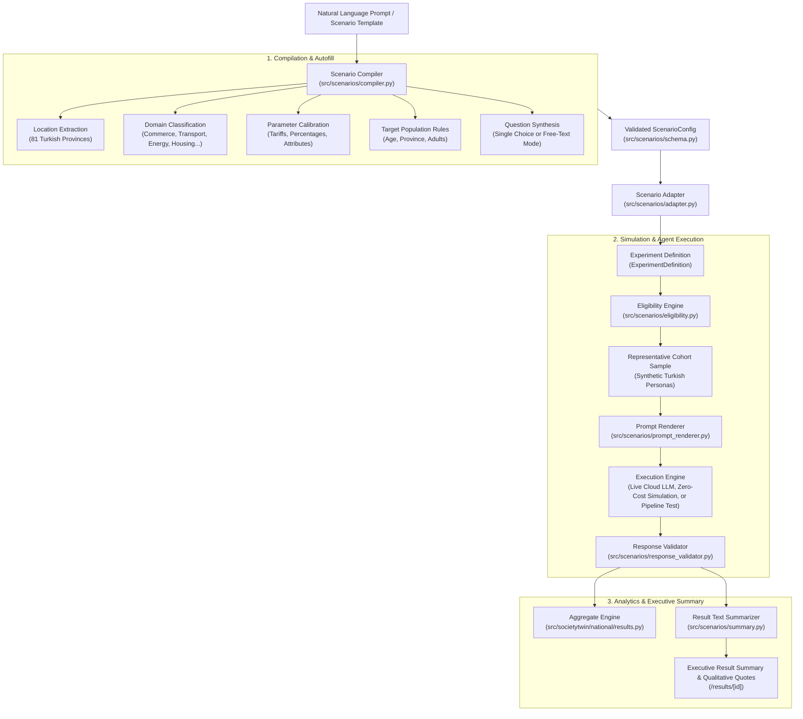

# Scenario Engine Architecture & Workflow Guide

The **Scenario Engine** is the policy modeling, natural language compilation, and demographic simulation bridge of the **AI-Powered Digital Society Twin**. It transforms conversational policy questions and municipal interventions into calibrated, demographic-aware experiments executed by synthetic citizen personas.

---

## 1. System Overview & Purpose

Policy analysts, researchers, municipal planners, and entrepreneurs rarely formulate policy in terms of low-level JSON configuration files or database schemas. Instead, they ask questions such as:

> *"What if bus and subway fares in Ankara increase by 30%? Will people switch to walking or driving?"*  
> *"What is the best location to open a cafe in Ankara?"*  
> *"Simulate an 18% electricity tariff increase in Bursa for residential households."*  
> *"How would university students in Istanbul respond to a 50% discount on transit passes?"*

The **Scenario Engine** bridges the gap between natural language questions and persona-conditioned agent experiments. It automatically:
1. **Extracts Geographic Context**: Identifies provinces across all 81 Turkish provinces (handling Turkish diacritics and suffixes like *Ankara'da*, *Bursa'da*, *İstanbul'da*).
2. **Classifies Policy Domains**: Identifies domain types (`transportation`, `housing`, `energy`, `commerce`, `social_policy`, `labor_market`, `health`).
3. **Calibrates Economic & Policy Parameters**: Infers baseline tariffs, proposed tariffs, percentage shifts, currency units, or business feasibility constraints.
4. **Determines Target Demographics**: Infers age ranges, income strata, or household types eligible for the scenario.
5. **Synthesizes Question Formats**:
   - **Single Choice**: Calibrated, balanced, non-leading multiple-choice options.
   - **Free-Text (Qualitative)**: Open-ended questions eliciting rich citizen perspectives in their own words.
6. **Screens Persona Eligibility**: Evaluates synthetic citizens against policy rules before prompting models.
7. **Validates AI Citizen Responses**: Strictly verifies agent choices against declared schemas, rejecting hallucinations.
8. **Synthesizes Executive Summaries**: Automatically generates comprehensive executive reports and qualitative takeaways using LLM intelligence or deterministic rule-based analysis.

---

## 2. End-to-End Workflow Diagram



---

## 3. Core Modules (`src/scenarios/`)

The Scenario Engine core is implemented in [`src/scenarios/`](file:///d:/Uni/EngDesign/AI-powered-digital-society-twin/src/scenarios):

### 3.1 `schema.py` — Strict Data Modeling
Defines validated Pydantic models for policy configurations:
- **`ScenarioConfig`**: Top-level model containing metadata, location, target population, policy parameters, and questionnaire.
- **`PolicyParameters`**: Holds calibrated economic figures (`baseline_fare`, `new_fare`, `increase_percentage`, `currency`, `policy_summary`, `custom_details`). Non-transit scenarios cleanly set transport attributes (`fare_category`) to `None`.
- **`TargetPopulation`**: Demographic screening bounds (`province_codes`, `age_min`, `age_max`, `adult_only`).
- **`QuestionConfig`**:
  - `type="single_choice"`: Structured choice questions with balanced options.
  - `type="free_text"`: Open-ended qualitative questions with `options=[]` and length bounds (`min_length`, `max_length`).

### 3.2 `compiler.py` — Zero-Shot NLP & Parameter Calibration
Transforms raw text prompts into a complete `ScenarioConfig`:
- **`extract_location(text)`**: Turkish diacritic-aware normalization matching all 81 provinces (e.g. *İçel/Mersin*, *Afyonkarahisar*, suffixes like *-de/-da/-ye*).
- **`detect_domain_and_category(...)`**: Classifies prompts into domains (`commerce`, `transportation`, `housing`, `energy`, `social_policy`, `labor_market`, `health`). For example, queries containing `cafe`, `restaurant`, `shop`, or `business` are categorized under `commerce`.
- **`calculate_tariff_change(...)`**: Automatically computes relative percentages, absolute new tariffs, or baseline values from partial prompt mentions.
- **`detect_target_population(...)`**: Detects demographic filters (e.g., student filters `age_min=18, age_max=25`, elderly discounts `age_min=65`).
- **`synthesize_questions(...)`**: Produces either calibrated single-choice questions or open-ended free-text questions based on prompt intent.
- **LLM + Heuristic Fallback**: Utilizes OpenAI completion if credentials exist, falling back seamlessly to deterministic rule-based heuristic extraction.

### 3.3 `adapter.py` — Pipeline Transformation & Catalog
Connects scenarios to the workbench experiment system:
- **`scenario_to_experiment_definition(scenario, cohort_id, ...)`**: Maps a `ScenarioConfig` into an executable `ExperimentDefinition`. Supports both `single_choice` and `free_text` response types.
- **`save_custom_scenario(scenario)`**: Persists custom scenarios to `experiments/policy_scenarios/scenarios/` as standardized YAML files.
- **`get_scenario(scenario_id)`**: Retrieves built-in or custom scenarios from the catalog.

### 3.4 `eligibility.py` — Deterministic Resident Screening
Evaluates whether a synthetic persona qualifies for a scenario:
- Evaluates constraints: province codes, age thresholds, household parameters.
- Returns ternary screening status:
  - `ELIGIBLE`: Persona meets all criteria.
  - `EXCLUDED`: Persona fails one or more criteria (with human-readable diagnostic reason).
  - `CANNOT_EVALUATE`: Missing persona attribute (fails closed to prevent corrupt experiments).

### 3.5 `prompt_renderer.py` — Context & Persona Injection
Renders standardized prompt envelopes:
- Injects demographic persona card (age, occupation, income bracket, household composition).
- Injects environmental context indicators (local inflation, TÜİK provincial indicators).
- Injects policy scenario description and tariff change details.
- Renders explicit instructions for open-ended free-text or single-choice JSON formats.
- Guarantees generator seed independence (does not leak synthetic seeds into prompts).

### 3.6 `response_validator.py` — Anti-Hallucination Guard
Ensures AI agents produce structured outputs matching controlled schemas:
- Strips markdown code fences (````json ... ````).
- For single-choice: validates the chosen option against declared option IDs, rejecting hallucinations.
- For free-text: validates non-empty string responses against character and length bounds.
- Captures agent rationale and explanation fields when enabled.

### 3.7 `summary.py` — Executive Result Text Summarizer
Generates comprehensive narrative result summaries and executive briefings from simulation data:
- **LLM Executive Synthesis**: When an LLM provider key (`OPENAI_API_KEY`) is active, it calls the LLM to synthesize the qualitative responses, identify key behavioral trends, extract representative quotes, and generate policy recommendations.
- **Deterministic Rule-Based Fallback**: Generates structured reports with plurality/consensus percentages, response depth metrics, and verbatim quotes when offline.
- **Failure Diagnostics**: Provides clear diagnostic banners if agent calls fail (e.g. HTTP 401 invalid API key), avoiding confusing 0% graphs.

---

## 4. Execution Engines & Pipelining

The simulation runner supports three distinct execution backends:

| Engine | Backend / Transport | AI Behavior | External API Calls / Cost | Purpose |
| :--- | :--- | :--- | :--- | :--- |
| **AI Citizen Agents (Live LLM provider)** | `matraix:live` | Full LLM cognitive reasoning (GPT-4o, Claude 3.5 Sonnet, Gemini) | **Yes** (Consumes API tokens; requires valid API key in `.env`) | Actual research, behavioral prediction, paper and thesis data collection. |
| **AI Citizen Agents (Zero-cost simulation)** | `matraix:fake` | Offline mock execution mode via MatrAIx batch runner | **Zero cost** (Runs 100% offline, zero network calls) | Testing prompt templates, verifying survey flow, and UI demonstrations without spending API credits. |
| **Pipeline Test (No AI / Offline)** | `stub:fake` | Deterministic mathematical hash runner | **Zero cost** (In-memory execution in milliseconds) | CI/CD automated test suites, verifying database persistence, stratification, and isolating data layer bugs. |

### Why Pipeline Testing is Essential
While **Pipeline Test** has zero AI intelligence by design, it is critical in scientific software:
1. **CI/CD Automated Testing**: Runs 80+ integration tests automatically without paid API keys or network latency.
2. **Isolation of Failures**: If a statistical aggregation fails, running a stub pipeline test immediately isolates whether the issue is in the demographic data pipeline vs. external LLM API rate limits.
3. **Pre-flight Budget Guard**: Allows researchers to verify cohort filters and questionnaire schema on a 1-second stub run before spending money on a 1,000-agent live LLM run.

---

## 5. REST API Endpoints (`src/societytwin/api/v2.py`)

The scenario engine exposes REST endpoints registered under `/api/v2`:

| Method | Endpoint | Description | Request / Query | Response |
|---|---|---|---|---|
| `POST` | `/api/v2/scenarios/from-prompt` | Zero-shot prompt compilation into validated scenario | `ScenarioPromptRequest` (`prompt`, `save`, `model`) | `ScenarioConfig` |
| `GET` | `/api/v2/scenarios` | Lists built-in and saved custom scenarios | Query: `category`, `province` | `ScenarioList` |
| `GET` | `/api/v2/scenarios/{id}` | Fetches full scenario YAML specification | None | `ScenarioConfig` |
| `GET` | `/api/v2/scenarios/{id}/experiment-definition` | Converts scenario to runnable experiment definition | Query: `cohort_id`, `question_id`, `seed` | `ExperimentDefinition` |
| `POST` | `/api/v2/scenarios` | Registers new custom scenario template | `ScenarioConfig` (JSON) | `ScenarioConfig` |
| `GET` | `/api/v2/runs/{run_id}/text-summary` | Generates or fetches executive result text summary | None | `ResultTextSummary` |

---

## 6. Frontend User Experience (`frontend/src/app/experiments/new/page.tsx`)

### Real-Time Autofill & Drawer Synchronization
- **Immediate Input Sync**: Typing into the prompt input automatically keeps the underlying survey question and policy description populated. The drawer fields are never blank, and the run button is immediately enabled.
- **Background Debounced Compilation**: A 700ms background debouncer invokes `/scenarios/from-prompt` while typing, auto-detecting the province, classifying the domain, and configuring the question format without requiring extra clicks.
- **Single-Click Simulation**: Clicking **`Simulate Policy`** compiles the prompt, matches or generates a compatible adult cohort, builds the plan, runs the agents, and routes directly to the results dashboard.
- **Customization Drawer**: Clicking **`Customize Question & Templates`** opens the drawer with all fields pre-filled from your prompt, allowing toggling between **Single Choice** and **Free-Text Answer**.
- **Optional Template Catalog**: The *"Saved Policy Templates"* dropdown is clearly separated as an optional benchmark catalog. Pre-saved transportation templates are only loaded if the user explicitly clicks *"Load Template"*.

### Results Dashboard (`frontend/src/app/results/[id]/page.tsx`)
- **Executive Result Summary Card**: Displays an executive headline, bulleted key behavioral findings, a copy-to-clipboard button, and an expandable full analytical Markdown report.
- **Citizen Free-Text Responses (Qualitative Findings)**: When open-ended free-text mode is selected, displays quote cards showing verbatim citizen feedback with synthetic ID and province badges.
- **Weighted Response Distribution**: Renders statistical choice distribution bars with 95% Wilson score confidence intervals and Kish effective sample sizes.

---

## 7. How to Run Tests

### Backend Unit & Integration Tests:
```powershell
.\.venv\Scripts\python.exe -m pytest tests/test_scenarios/ tests/national/test_scenario_pipeline.py tests/national/test_api_v2.py -v
```
*Executes all 81 scenario and national pipeline test cases, verifying location extraction, tariff math, domain classification, free-text schemas, LLM result synthesis, demographic screening, and API endpoints.*

### Frontend Typecheck:
```powershell
cd frontend
npx tsc --noEmit
```
*Verifies 0 TypeScript compilation errors across all pages, components, and API client interfaces.*
