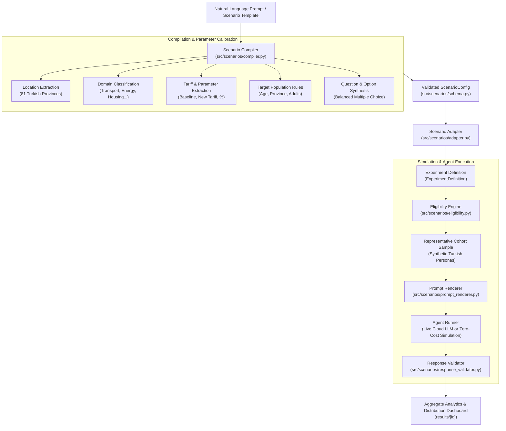

# Scenario Engine Architecture & Workflow Guide

The **Scenario Engine** is the policy modeling, zero-shot compilation, and demographic simulation bridge of the **AI-Powered Digital Society Twin**. It transforms high-level policy questions and interventions into calibrated, demographic-aware experiments executed by synthetic citizen agents.

---

## 1. System Overview & Purpose

Policy analysts, researchers, and government officials rarely formulate policy in terms of low-level JSON configuration files. Instead, they ask questions such as:

> *"What if bus and subway fares in Ankara increase by 30%? Will people switch to walking or driving?"*  
> *"Simulate an 18% electricity tariff increase in Bursa for residential households."*  
> *"How would university students in Istanbul respond to a 50% discount on transit passes?"*

The **Scenario Engine** bridges the gap between natural language policy questions and persona-conditioned agent experiments. It automatically:
1. **Extracts Geographic Context**: Identifies provinces across all 81 Turkish provinces (handling Turkish diacritics and suffixes like *Ankara'da*, *Bursa'da*, *İstanbul'da*).
2. **Calibrates Economic & Policy Parameters**: Infers baseline tariffs, proposed tariffs, percentage shifts, and currency units.
3. **Determines Target Demographics**: Infers age ranges, income strata, or household types eligible for the policy.
4. **Synthesizes Balanced Survey Questions**: Produces structured, non-leading questions with controlled, valid response options.
5. **Screens Persona Eligibility**: Evaluates synthetic citizens against policy rules before prompting models.
6. **Validates AI Citizen Responses**: Strictly verifies agent choices against defined option IDs, rejecting hallucinations.

---

## 2. End-to-End Workflow Diagram



---

## 3. Core Modules (`src/scenarios/`)

The Scenario Engine core is implemented in [`src/scenarios/`](file:///d:/Uni/EngDesign/AI-powered-digital-society-twin/src/scenarios):

### 3.1 `schema.py` — Strict Data Modeling
Defines validated Pydantic models for policy configurations:
- **`ScenarioConfig`**: Top-level model containing metadata, location, target population, policy parameters, and questionnaire.
- **`PolicyParameters`**: Holds calibrated economic figures (`baseline_fare`, `new_fare`, `increase_percentage`, `currency`, `policy_summary`, `custom_details`).
- **`TargetPopulation`**: Demographic screening bounds (`province_codes`, `age_min`, `age_max`, `adult_only`).
- **`QuestionConfig` & `ChoiceOption`**: Multiple-choice survey questions with unique IDs and descriptive labels.

### 3.2 `compiler.py` — Zero-Shot NLP & Parameter Calibration
Transforms raw text prompts into a complete `ScenarioConfig`:
- **`extract_location(text)`**: Turkish diacritic-aware normalization matching all 81 provinces (e.g. *İçel/Mersin*, *Afyonkarahisar*, suffixes like *-de/-da/-ye*).
- **`calculate_tariff_change(...)`**: Automatically computes relative percentages, absolute new tariffs, or baseline values from partial prompt mentions.
- **`detect_domain_and_category(...)`**: Classifies prompts into domains (`transportation`, `housing`, `energy`, `social_policy`, `labor_market`, `health`).
- **`detect_target_population(...)`**: Detects demographic filters (e.g., student filters `age_min=18, age_max=25`, elderly discounts `age_min=65`).
- **`synthesize_questions(...)`**: Generates balanced, non-leading survey questions with actionable choice options (e.g., *Affordability*, *Modal Shift*, *Support/Opposition*).
- **LLM + Heuristic Fallback**: Utilizes OpenAI/cloud LLM completion if available, falling back seamlessly to deterministic rule-based heuristic extraction.

### 3.3 `adapter.py` — Pipeline Transformation & Catalog
Connects scenarios to the workbench experiment system:
- **`scenario_to_experiment_definition(scenario, cohort_id, ...)`**: Maps a `ScenarioConfig` into an executable `ExperimentDefinition` (scenario parameters, survey task options, province context indicators, and cohort settings).
- **`save_custom_scenario(scenario)`**: Persists custom scenarios to `experiments/policy_scenarios/scenarios/` as standardized YAML files.
- **`get_scenario(scenario_id)`**: Retrieves built-in or custom scenarios from the catalog.

### 3.4 `eligibility.py` — Deterministic Resident Screening
Evaluates whether a synthetic persona qualifies for a scenario:
- Evaluates constraints: province codes, age thresholds, household parameters.
- Returns ternary screening status:
  - `ELIGIBLE`: Persona meets all criteria.
  - `EXCLUDED`: Persona fails one or more criteria (with human-readable diagnostic reason).
  - `CANNOT_EVALUATE`: Missing persona attribute (fails closed to prevent corrupt experiments).

### 3.5 `prompt_renderer.py` — Context & Persona Injection
Renders standardized prompt envelopes:
- Injects demographic persona card (age, occupation, income bracket, household composition).
- Injects environmental context indicators (local inflation, TÜİK provincial indicators).
- Injects policy scenario description and tariff change details.
- Guarantees generator seed independence (does not leak synthetic seeds into prompts).

### 3.6 `response_validator.py` — Anti-Hallucination Guard
Ensures AI agents produce structured outputs matching controlled schemas:
- Strips markdown code fences (````json ... ````).
- Validates the chosen option against the declared option IDs.
- Flags and rejects illegal options (e.g. an agent saying *"maybe"* when only `yes` and `no` are allowed).
- Captures agent rationale and explanation fields when enabled.

---

## 4. REST API Endpoints (`src/societytwin/api/v2.py`)

The scenario engine exposes REST endpoints registered under `/api/v2/scenarios`:

| Method | Endpoint | Description | Request Body | Response |
|---|---|---|---|---|
| `POST` | `/api/v2/scenarios/from-prompt` | Zero-shot prompt compilation | `ScenarioPromptRequest` (`prompt`, `save`, `model`) | `ScenarioConfig` |
| `GET` | `/api/v2/scenarios` | Lists built-in and saved custom scenarios | Query params: `category`, `province` | `ScenarioList` |
| `GET` | `/api/v2/scenarios/{id}` | Fetches full scenario YAML specification | None | `ScenarioConfig` |
| `GET` | `/api/v2/scenarios/{id}/experiment-definition` | Converts scenario to runnable experiment definition | Query: `cohort_id`, `question_id`, `seed` | `ExperimentDefinition` |
| `POST` | `/api/v2/scenarios` | Registers new custom scenario template | `ScenarioConfig` (JSON) | `ScenarioConfig` |

---

## 5. Frontend User Experience (`frontend/src/app/experiments/new/page.tsx`)

The UI provides a dual-mode experience tailored for both policy generalists and expert researchers:

### Mode 1: Minimalist Prompt-First Simulation (Default)
1. **Policy Simulation Prompt Card**:
   - A single natural language input area supporting Turkish and English.
   - Example prompt chips (*"Ankara transit fares increase by 30%"*, *"18% electricity tariff increase in Bursa"*).
   - **Simulate Policy Button**: Executes the entire pipeline in 1 click (auto-creates default adult cohort if none exists, compiles prompt, builds plan, executes simulation, and routes to `/results/{run_id}`).
   - **Progress Feedback Banner**: Displays real-time pipeline status (*"Analyzing prompt and compiling policy parameters..."* &rarr; *"Sampling representative cohort..."* &rarr; *"Simulating persona responses..."*).

### Mode 2: Advanced Settings & Quick Toggles
- **Quick Settings Bar**:
  - **Sample Size**: Select `10`, `20`, `50`, or `100` active personas.
  - **Execution Engine**: Choose between `AI Citizen Agents (Zero-cost simulation)`, `AI Citizen Agents (Live LLM provider)`, or `Pipeline Test (No AI)`.
  - **Target Region**: Auto-detect from prompt or override with specific province.
- **Expandable 6-Step Multi-Step Wizard** (Toggled via **▼ Show Advanced** or **Compile & Customize in Wizard →**):
  - **Step 1: Scenario**: Fine-tune parameter names, numerical values, units, and descriptions.
  - **Step 2: Task**: Edit survey question wording and JSON multiple-choice options.
  - **Step 3: Environment**: Select province-level TÜİK indicators (demographics, labor, income).
  - **Step 4: Cohort**: Select saved cohorts and sampling methods (weighted, random, stratified).
  - **Step 5: Model**: Configure temperature, attempts per call, and budget cost guards.
  - **Step 6: Review**: Inspect estimated calls, token counts, cost estimate, and exact persona prompts before running.

---

## 6. Execution Engines

The simulation runner supports three distinct execution backends:

1. **`AI Citizen Agents (Zero-cost simulation)`** (`matraix:fake`):
   - Runs the complete multi-agent pipeline in an isolated subprocess.
   - Evaluates persona cards and generates schema-valid responses without making external API calls.
   - **Cost**: $0.00. Ideal for rapid iteration, testing, and demonstrations.
2. **`AI Citizen Agents (Live Cloud LLM)`** (`matraix:live`):
   - Invokes real cloud LLMs (e.g., Anthropic Claude, OpenAI GPT) via provider keys configured in the server environment.
   - Personas evaluate questions using full persona conditioning and contextual indicators.
   - Guarded by `SOCIETYTWIN_ENABLE_LIVE_EXECUTION` and budget cost caps.
3. **`Pipeline Test (Stub)`** (`stub:fake`):
   - Offline deterministic mock runner for CI/CD pipelines and unit testing.

---

## 7. How to Run Tests

### Backend Unit & Integration Tests:
```powershell
.\.venv\Scripts\python.exe -m pytest tests/test_scenarios/ -v
```
*Covers 35 tests verifying location extraction, tariff math, domain classification, demographic screening, YAML loading, response validation, and API endpoints.*

### Frontend Typecheck & Vitest Suites:
```powershell
npm --prefix frontend run typecheck
npm --prefix frontend run test
```
*Verifies TypeScript compilation and 30 component/page Vitest test cases.*
