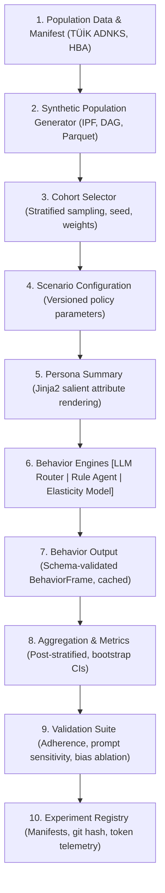

# SocietyTwin v2.1: Technical Architecture Specification

**Project:** Engineering Design II — AI-Powered Digital Society Twin for Türkiye  
**Status:** PROPOSED (Revision of v2 with scientific-validity, reproducibility, and consistency fixes)  
**Author:** Technical Architecture Stream  
**Core Pipeline:**  
`TÜİK Data + Manifest → Population Generator → Cohort Sampler → Scenario Config → Persona Summary → Behavior Engines [LLM Router | Rule Baseline | Aggregate Elasticity] → BehaviorFrame → Aggregation & CIs → Validation Suite → Experiment Registry`

---

## 1. Purpose and Design Principles

SocietyTwin simulates how a synthetic Turkish population reacts to public policy changes (such as municipal transit fare adjustments) through controlled, reproducible experiments. A statistically grounded synthetic population supplies small, sampled cohorts. Behavior engines—including LLM agents alongside zero-cost empirical baselines—produce structured decisions, which are aggregated into society-level indicators with bootstrap confidence intervals.

| Principle | Meaning in Practice |
| :--- | :--- |
| **Scenario exploration, not forecasting** | Outputs are comparative indicators for exploring policy counterfactuals. They are never deterministic predictions of human behavior. |
| **Decoupled scale** | Population size ($10\text{K}–100\text{K}+$) does not drive LLM costs. The full population is generated with mathematical rules ($0 cost); only small, sampled cohorts ($50–150$) are queried. |
| **Baselines before claims** | Every LLM experiment is executed alongside a **Rule-Based Agent** and an **Aggregate Elasticity Model** on identical personas. Without baselines, LLM value cannot be established. |
| **Provenance everywhere** | Every persona attribute is explicitly tagged with its source classification: `observed_marginal`, `derived`, or `assumed`. |
| **Honest reproducibility** | True determinism is guaranteed at the **replay level** (cryptographically hashed response caching), not at the LLM generation level. |
| **Population-level only** | Results describe cohorts and sub-populations. No individual real person is modeled, predicted, or identified. Strict KVKK Art. 6 compliance. |

---

## 2. Answers to Core Operational Questions

### 2.1 Minimum Persona Information Needed
For the urban transit fare policy scenario ($40 \text{ TL} \rightarrow 48 \text{ TL}$), the minimal sufficient attribute set is strictly restricted to **7 decision-salient dimensions**:
1. **Financial Constraint:** `income_decile` (or broad category: low, middle, high) to define budgetary constraints.
2. **Geographic Friction:** `location_district` (e.g., Çankaya vs. Mamak vs. Keçiören) to establish trip distances, topography, and transit availability.
3. **Current Mobility Habits:** `primary_commute_mode` (bus/metro, walking, car, dolmuş) and `trip_frequency` (rides/week) to calculate baseline expenditure.
4. **Alternative Availability:** `car_ownership` (none vs. household car) to determine modal switching feasibility.
5. **Role & Demographics:** `occupation_status` (student, civil servant/memur, private sector, pensioner/emekli) to identify institutional schedules and concessionary fare eligibility.
6. **Assumed Parameter:** `price_sensitivity` (assumed trait, documented and varied across sensitivity tests).

*All extraneous traits (e.g., personality inventories, unrelated consumer preferences) are omitted to prevent prompt dilution and token waste.*

### 2.2 Statistically Sufficient Personas per Cohort
- **Target Confidence Interval:** Choosing a standard margin of error $E \le \pm 0.08$ (8 percentage points) at $95\%$ confidence ($Z = 1.96$) under maximal variance ($p = 0.5$):
  $$n = \frac{Z^2 \cdot p(1-p)}{E^2} = \frac{1.96^2 \cdot 0.25}{0.08^2} \approx 150 \text{ personas}$$
- **Stratified Cohort Layout:** 18 strata ($\text{Income [3]} \times \text{District [3]} \times \text{Student [2]}$) with a minimum cell size $n_{\text{stratum}} \ge 5$ requires a minimum of $90$ personas. A standard cohort of **$100$ to $150$ personas** provides sufficient statistical power for post-stratified estimators.
- **Repetition ($k$ samples):** Each persona is queried $k = 3$ to $5$ times to capture the stochastic response distribution.

### 2.3 Task Allocation: Rules vs. ML vs. LLMs
- **Strictly Rules / Math / Statistical ($0 Cost):**
  - Population generation (Iterative Proportional Fitting, joint marginal fitting).
  - Monthly budget impact calculation: $\text{budget\_share} = (\text{fare} \times \text{trips}) / \text{income}$. Never computed by LLM.
  - Aggregation, post-stratification weighting, and bootstrap confidence intervals.
  - Baseline price elasticity curves ($\epsilon \approx -0.35$).
- **Strictly LLM Agents:**
  - Multi-attribute behavioral trade-offs under competing constraints (balancing cost, physical walking effort, schedule urgency, and comfort).
  - Counterfactual scenario framing (evaluating framing effects of municipal subsidies or subscription cards).
  - Hypothesis exploration through structured options plus "other" free text.

### 2.4 Maximum Cost and Runtime Targets
- **Single Trial Profile:** ~520 prompt tokens, ~65 output tokens = ~585 total tokens per call.
- **Simulation Scale:** 3 fare levels ($+10\%, +20\%, +40\%$) $\times 100$ personas $\times 3$ repetitions ($k=3$) = $900$ total calls (~526k tokens).
- **Maximum Cost Cap:** $\mathbf{\le \$0.50}$ per complete experiment using fast, low-cost tiers (`gpt-4o-mini`, `claude-3-5-haiku`, `gemini-1.5-flash`), with typical spend around **$\$0.10 - \$0.15$**.
- **Maximum Runtime Cap:** $\mathbf{\le 180 \text{ seconds (3 minutes)}}$ at concurrency limit $N = 5$.

### 2.5 Cheap Aggregation Output Format
Output is enforced as a strict tabular **`BehaviorFrame`** via closed enum JSON. Free-form text is logged in telemetry for auditing only and excluded from mathematical aggregation:
```json
{
  "decision": "switch_some_trips_to_walking",
  "rationale": "Student on low budget in Çankaya; trips under 2 km will be walked."
}
```
All society-level indicators are computed via vectorized grouped operations in DuckDB / Polars in $<15 \text{ ms}$.

---

## 3. The Canonical 10-Stage Pipeline



1. **Population Data:** Official TÜİK data ingested with checksums into `data/manifest.yaml`.
2. **Synthetic Population Generation:** Vectorized DAG generator fitting joint marginals via Iterative Proportional Fitting (IPF). Outputs Parquet with embedded provenance metadata.
3. **Cohort Selection:** Stratified sampling drawing representative records with explicit sampling weights and reproducible seeds.
4. **Scenario Definition:** Versioned JSON specification defining policy parameters (baseline vs. multi-level adjustments).
5. **Persona Summary:** Jinja2 template rendering only the 7 scenario-salient attributes in neutral phrasing.
6. **Behavior Engines:** Unified interface executing:
   - *Rule-based agent* (Empirical micro-economic elasticity rules — $0 cost).
   - *Aggregate elasticity model* (Cohort-level econometric baseline — $0 cost).
   - *LLM agent* (Queried via Model Router).
7. **Behavior Output:** Validated records conforming to the `BehaviorFrame` contract, stored with $k$ repeated samples per persona.
8. **Aggregation & Metrics:** Post-stratified estimation of mode shifts, budget burden, and district disparities with bootstrap confidence intervals.
9. **Validation Suite:** Automated pytest gates evaluating persona adherence, prompt sensitivity, cross-model agreement, and district bias ablation.
10. **Experiment Registry:** Persistent store recording code version, prompt hash, model version, telemetry, and outputs.

---

## 4. Architectural Decision: MatrAIx Integration Strategy

| Option | Definition | Trade-Off & Recommendation |
| :--- | :--- | :--- |
| **Option A: Reuse Parts (Lego Pieces)** | Extract MatrAIx prompt templates, structured survey logic, and schema patterns directly into SocietyTwin. | **RECOMMENDED TARGET.** Clean TÜİK alignment, zero container overhead, crystal-clear academic novelty for TÜBİTAK. |
| **Option B: Build Inside MatrAIx** | Fork MatrAIx repo and build SocietyTwin directly inside it. | **NOT RECOMMENDED.** Inherits massive global schema (1,290 dimensions), Docker desktop agents, and obscures our contribution. |
| **Option C: Separate but Connected** | Keep MatrAIx as an external service called via CLI/REST. | **FALLBACK ONLY.** Viable only if Sprint 0 shows MatrAIx job runners save more integration time than IPC costs. |

**Sprint 0 Decision Protocol:**  
Sprint 0 uses MatrAIx as-is on the existing WSL2 setup to measure exact token costs and JSON reliability. If Option A can reproduce the survey protocol in clean Python in $<200$ lines of code (as proven in our prototype), Option A is immediately frozen.

---

## 5. Behavior Engines and Output Contract

### 5.1 The `BehaviorFrame` Schema
All three engines output identical tabular records:
```text
persona_id: str
stratum: str
decision: Enum (1 to 6)
budget_share: float (Deterministically computed in code: fare * trips / income)
weight: float (Sampling weight)
sample_index: int (1 to k)
engine: str ("llm" | "rule_based" | "aggregate_elasticity")
engine_version: str
```

### 5.2 Default Decision Set (Ankara Fare Hike)
Mutually exclusive options requiring the persona to select their dominant behavioral adaptation:
1. `continue_public_transport`: Continue using public transport as before.
2. `reduce_optional_trips`: Reduce optional, non-essential trips.
3. `switch_some_trips_to_walking`: Switch some short/medium trips to walking.
4. `use_car_carpool`: Use car or carpool for some trips.
5. `switch_transport_mode`: Switch to an alternative motorized mode entirely (e.g., taxi, dolmuş/minibüs, scooter).
6. `other`: Alternative action, with free-text explanation.

---

## 6. Model Router and Reproducibility Policy

1. **Model Router:**  
   - Unified provider interface via `LiteLLM` supporting Anthropic, OpenAI, Google Gemini, and local Ollama models.
   - **Single Model per Run:** To prevent confounding variables, an individual experiment run uses exactly one model configuration. Cross-model comparisons are conducted as separate experimental runs.
   - Externalized model names in `configs/models.yaml`.
2. **Replay-Level Reproducibility:**  
   - LLMs are inherently non-deterministic even at temperature 0.  
   - Every completed prompt is cryptographically hashed: $\text{hash}(\text{model\_id}, \text{prompt}, \text{params})$.
   - Responses are cached in SQLite/DuckDB. Replay mode serves identical cached decisions for exact historical reproduction.
3. **Budget Guard:**  
   - Hard stop spend cap enforced at the router layer. Execution terminates if cumulative trial cost exceeds the limit.

---

## 7. Validation Suite (Pytest Verification Gate)

A dedicated work package (WP3) enforces seven automated validation checks before simulation findings can be published:
1. **Persona Adherence:** Flip a single attribute (e.g., car ownership: `True` $\rightarrow$ `False`) and verify that transit/walking choices shift in the expected direction.
2. **Prompt Sensitivity:** Paraphrase the policy brief without changing underlying numbers; measure maximum distribution drift (must not exceed threshold $\Delta \le 5\%$).
3. **External Plausibility:** Compare aggregate fare response against empirical transit elasticity literature ($\epsilon \in [-0.2, -0.5]$).
4. **Cross-Model Agreement:** Compare distributions between Claude 3.5 Sonnet, GPT-4o-mini, and Gemini 1.5 Flash.
5. **Baseline Comparison:** Verify that LLM distributions provide measurable behavioral nuances beyond simple linear rule thresholds.
6. **Bias Ablation:** Strip geographic names (replace *"Çankaya"* or *"Mamak"* with neutral *"District A"* and *"District B"*); report distribution shifts to detect spatial stereotyping.
7. **Generator Fit:** Chi-square goodness-of-fit confirming synthetic marginals match official TÜİK tables.

---

## 8. Technology Stack

| Layer | Technology | Role |
| :--- | :--- | :--- |
| **Presentation** | Next.js, TypeScript, TailwindCSS, Recharts | Scenario setup, population pyramids, mode-shift distributions |
| **API** | FastAPI (Python 3.12) | Asynchronous simulation orchestration, experiment endpoints |
| **Population Engine** | NumPy, Polars | Vectorized joint generation, IPF fitting, DAG dependencies |
| **Behavior Engine** | LiteLLM, Pydantic, Jinja2 | Prompt rendering, schema validation, multi-model execution |
| **Analytics Engine** | DuckDB, Pandas, SciPy | Post-stratification, bootstrap confidence intervals, metrics |
| **Storage** | Parquet, DuckDB, JSON | 100K population files, telemetry logs, experiment manifests |
| **Testing** | Pytest, Hypothesis | Automated validation gates, schema tests, property invariants |

---

## 9. Work Packages and Team Allocation

| WP | Scope | Owner | Key Deliverables |
| :--- | :--- | :--- | :--- |
| **WP1** | **Data & Population** | **Koray** | TÜİK ingestion, provenance tagging, IPF generator, cohort sampler. |
| **WP2** | **Behavior Engine & Router** | **Pakhlavon** | Model Router with LiteLLM, prompt caching, rule & aggregate baselines, `BehaviorFrame` contract. |
| **WP3** | **Validation & Benchmarking** | **Azra** | Adherence tests, bias ablation, comparison with MatrAIx / AgentPersonaBench. |
| **WP4** | **Integration & Project Management** | **Bejan** | System orchestration, FastAPI endpoints, TÜBİTAK proposal coordination, experiment registry. |
| **WP5** | **Methodology & Literature** | **Sam** | Academic justification of generative social simulation, survey bias analysis, formal methodology defense. |

---

## 10. Phased Roadmap

1. **Sprint 0 (Measure First — Complete):** Execute baseline personas in MatrAIx; verify token telemetry and JSON reliability; confirm Option A architecture.
2. **Sprint 1 (Contracts & Router):** Freeze `BehaviorFrame` schema, implement LiteLLM router with cryptographic caching and telemetry tracker.
3. **Sprint 2 (Population Engine):** Ingest official TÜİK ADNKS tables for Ankara districts; implement vectorized IPF generator producing 10,000 synthetic records.
4. **Sprint 3 (Policy Experiment):** Run Ankara Transit Fare experiment across 3 fare levels with 100 personas and $k=3$ samples; execute the complete validation suite.
5. **Sprint 4 (UI & Delivery):** Connect Next.js dashboard; compile final technical report and TÜBİTAK documentation.
