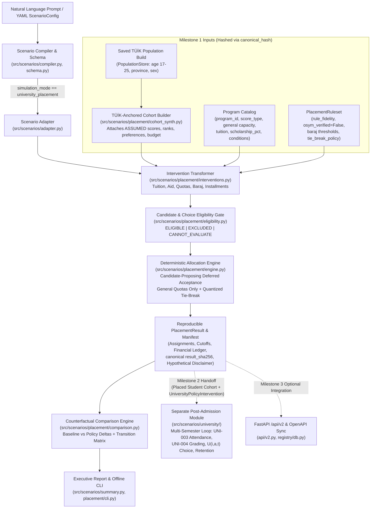

# Implementation Blueprint: Deterministic University Placement Simulator & Policy Scenario Engine Integration

**Target Branch:** `scenario-engine` (base commit: `943407b`)  
**Owner:** Pakhlavon (Scenario Engine & Simulation Logic)  
**Companion Specifications:** [scenario-engine.md](scenario-engine.md) · *SocietyTwin University Decision Simulation Blueprint (v2.0, 17 Nov 2026)*  
**Status:** Milestone 1 Implemented & Verified (`src/scenarios/placement/` + `src/scenarios/` integrations)

> [!IMPORTANT]
> **Mandatory Epistemic & Labeling Rule:** Until verified ÖSYM YKS / YÖK Atlas capacity, quota, and *kılavuz* eligibility datasets are formally ingested and checksum-verified, **all placement rules, score thresholds (*taban puan* / *başarı sırası barajı*), capacities, and synthetic candidate cohorts MUST be explicitly labeled as simplified/hypothetical (`osym_verified: false`, `rule_fidelity: "hypothetical_simplified"`)**. The simulator must never claim exact reproduction of official ÖSYM placement outcomes.

---

## 1. Locked Architectural Decisions (Milestone 1 Baseline)

The following four scope decisions govern implementation on the `scenario-engine` branch:

| Decision Area | Locked Choice | Architectural Consequence |
| :--- | :--- | :--- |
| **1. MVP PR Boundary** | **Offline simulator first** | Milestone 1 delivers the offline Python/CLI placement engine, Scenario Engine extensions (`src/scenarios/`), and full pytest suite. **Zero edits** to `api/v2.py`, `registry/db.py`, or `frontend/openapi.json` in Milestone 1, avoiding OpenAPI snapshot drift and frontend sync overhead. |
| **2. Candidate Cohort** | **TÜİK-anchored synthetic cohort** | Candidate demographics (`province_code`, `age`, `sex`, `education_level`, `urbanicity`, `population_weight`) are sampled from saved [`LoadedPopulation`](../src/societytwin/national/store.py#L133-L153) builds without altering `records.parquet`. Synthesized exam scores, ranks, preferences, and liquid budgets are explicitly tagged [`Evidence.ASSUMED`](../src/societytwin/national/vocab.py#L156). |
| **3. Sub-Quota Scope** | **General quotas only** | Milestone 1 models a single `general` capacity (`capacity >= 0`) per `ProgramOffering`. Scholarship tiers (`%100 Burslu`, `%50 İndirimli`, `%25 İndirimli`, `Ücretli`) are represented as distinct `program_id` entries, matching ÖSYM's distinct-code structure without multi-bucket spillover complexity. |
| **4. Multi-Semester Loop** | **Separate university module** | Admission allocation (`src/scenarios/placement/`) is decoupled from post-admission multi-semester student dynamics (`src/scenarios/university/`). Both share `UniversityPolicyIntervention` in [`src/scenarios/schema.py`](../src/scenarios/schema.py) via a clean handoff contract. |

---

## 2. Executive Summary & Dual-Layer Alignment

Pakhlavon's existing **Scenario Engine** ([`src/scenarios/`](../src/scenarios)) compiles natural language policy prompts into validated [`ScenarioConfig`](../src/scenarios/schema.py#L209-L294) objects, screens resident eligibility deterministically, bridges to [`ExperimentDefinition`](../src/societytwin/national/experiments.py#L262-L275), and renders/validates/summarizes independent persona responses.

To fulfill the new placement responsibilities and integrate cleanly with the *University Decision Simulation Blueprint (v2.0)*:

1. **Research & Model Placement Rules:** Explicit Turkish YKS/ÖSYM-inspired score-type restrictions (`SAY`, `EA`, `SÖZ`, `DİL`, `TYT`), candidate eligibility gates, success-rank thresholds (*başarı sırası barajı*), `general`-quota capacities, and tie-breaking policies—strictly separated into versioned, provenance-tagged `PlacementRuleset` configs.
2. **Deterministic Allocation Engine:** Offline Candidate-Proposing Deferred Acceptance (Gale–Shapley) engine with fixed-point score quantization and canonical tie-breaking, guaranteeing permutation invariance, seat-capacity conservation, and stability (no justified envy).
3. **Unavailable Choices, Unplaced Candidates, Ties & Constraints:** Full per-choice diagnostic trail (`UNKNOWN_PROGRAM`, `ZERO_CAPACITY`, `SCORE_TYPE_MISMATCH`, `RANK_THRESHOLD_NOT_MET`, `AFFORDABILITY_EXCLUDED`, `CAPACITY_FULL`) and fail-closed `CANNOT_EVALUATE` semantics matching [`eligibility.py`](../src/scenarios/eligibility.py#L19-L23).
4. **University Economic & Educational Interventions:** Native Scenario Engine support in `schema.py` and `compiler.py` for admission-stage interventions (`UNI-001` tuition changes, `UNI-002` need-based aid, `UNI-005` seat/quota reductions, `UNI-006` installment plans, `OSYM-BARAJ` rank threshold shifts, `OSYM-SCHOLAR` scholarship tier shifts), plus shared configuration fields consumed by the separate `src/scenarios/university/` module (`UNI-003` attendance minimums, `UNI-004` grading shifts, multi-semester retention).
5. **Reproducible Outputs & Scenario Comparisons:** Cryptographic input/output digests via [`canonical_hash`](../src/societytwin/common.py#L56-L57), paired baseline-vs-intervention comparison reports, candidate migration matrices, and Common Random Numbers (CRN) multi-replication support.

Per Section 2 & Section 8 of the *University Decision Simulation Blueprint (v2.0)*, all money, eligibility gates, seat constraints, and aggregate metrics remain strictly computed by auditable deterministic components—never free-form LLM output.

---

## 3. Codebase Gap Analysis (`scenario-engine` Branch)

A direct inspection of the `scenario-engine` branch establishes exact extension points and current constraints:

| Module (Current State) | What Already Exists | Exact Gaps for University Placement & Interventions |
| :--- | :--- | :--- |
| [`src/scenarios/schema.py`](../src/scenarios/schema.py) | `ScenarioConfig`, `PolicyParameters` (`baseline_fare`, `new_fare`, `increase_percentage`, `custom_details`), `PopulationFilterConfig`, `QuestionConfig` (`min_length=1` required), `ScenarioMetadata.hypothetical`. | No `simulation_mode` discriminator; no typed `UniversityPolicyIntervention` model (tuition, aid budget, installment plan, quota shifts, baraj thresholds, attendance/grading levers); `questions` requires `min_length=1`, forcing dummy survey questions on pure deterministic placement runs. |
| [`src/scenarios/compiler.py`](../src/scenarios/compiler.py) | `detect_domain_and_category` maps `student`/`university`/`scholarship` to `("education", "student_support")`; `detect_target_population` sets `age 18..26`. | `synthesize_questions` lacks `"university_placement"` / `"university_policy"` branches (falls through to generic `else`); `extract_percentages_and_numbers` only parses transit/tariff currency patterns, missing tuition %, aid budget %, seat quota %, rank thresholds (`ilk 50 bin`), score types (`SAY/EA/SÖZ/DİL/TYT`), and installment counts. |
| [`src/scenarios/eligibility.py`](../src/scenarios/eligibility.py) | Ternary [`EligibilityStatus`](../src/scenarios/eligibility.py#L19-L23) (`ELIGIBLE`, `EXCLUDED`, `CANNOT_EVALUATE`) with fail-closed missing-attribute diagnostics. | Evaluates demographic filters only (`age`, `province_code`, `sex`, `marital_status`, `education_level`). Lacks academic candidate gates (score-type presence, minimum score, success-rank baraj, diploma status, preference validity, affordability/liquidity threshold). |
| [`src/scenarios/adapter.py`](../src/scenarios/adapter.py) | Maps `ScenarioConfig` to `ExperimentDefinition` via `scenario_to_experiment_definition`; `_ENFORCED_FILTERS` enforces 5 demographic fields. | No adapter path converting `ScenarioConfig` into an offline `PlacementSimulationSpec` or handing off placed cohorts to `src/scenarios/university/`; `_ENFORCED_FILTERS` leaves `education_levels`/`sexes`/`marital_statuses` in `unenforced_filters`. |
| [`src/scenarios/summary.py`](../src/scenarios/summary.py) | Deterministic + gated LLM executive summary (`generate_result_text_summary`) for survey distributions and free-text quotes. | No deterministic narrative builder for placement metrics (placement rate, program cutoffs, unplaced breakdown, tie diagnostics) or counterfactual paired deltas. |
| [`src/societytwin/national/store.py`](../src/societytwin/national/store.py) & [`cohorts.py`](../src/societytwin/national/cohorts.py) | TÜİK-calibrated resident Parquet `SCHEMA` (`age`, `sex`, `marital_status`, `education_level`, `labour_status`, `household_size_class`, `household_type`, `urbanicity`) + seeded samplers. | Official TÜİK resident records **do not contain** exam scores, preference rankings, liquid cash, tuition obligations, or student status ([CURRENT_SYSTEM_HANDOVER.md](CURRENT_SYSTEM_HANDOVER.md#L198-L210)). **Constraint:** Never mutate `records.parquet`; build a separate TÜİK-anchored `CandidateCohort` artifact tagging synthetic attributes as `Evidence.ASSUMED`. |
| [`src/societytwin/api/v2.py`](../src/societytwin/api/v2.py) & [`tests/api/test_api_contract.py`](../tests/api/test_api_contract.py#L181-L190) | FastAPI `/api/v2` routes with strict OpenAPI snapshot verification against `frontend/openapi.json`. | **Protected in Milestone 1:** Keeping Milestone 1 strictly offline under `src/scenarios/placement/` avoids OpenAPI snapshot drift and frontend schema churn while core simulation logic is built and tested. |
| [`pyproject.toml`](../pyproject.toml#L22-L31) | Packages `include = ["societytwin*", "scenarios*"]` from `src/`. | `src/simulation/` is an unconfigured v1 placeholder. Placing modules under `src/scenarios/placement/` (Milestone 1) and `src/scenarios/university/` (Milestone 2) automatically packages both cleanly under `scenarios*`. |

---

## 4. System Architecture & Module Separation

The architecture enforces a clean boundary between **Milestone 1 (Offline Placement Simulator)**, **Milestone 2 (Separate Post-Admission University Decision Module)**, and **Milestone 3 (Optional API v2 / UI Exposure)**:



---

## 5. Domain Model: Placement Rules, Cohorts & Guardrails

### 5.1 Score Types & Placement Score Calculation

Model Turkish YKS score domains as a strict `ScoreType` enum:

| `ScoreType` | Domain Covered | Typical Programs (Illustrative) | Notes in Ruleset |
| :--- | :--- | :--- | :--- |
| `TYT` | Basic Proficiency (2-year Associate) | Associate (*Önlisans*) programs | Also optionally checked as prerequisite for 4-year `SAY`/`EA`/`SÖZ`/`DİL` eligibility (`require_tyt_prerequisite`). |
| `SAY` | Quantitative / Science | Medicine, Engineering, Architecture, CS, Pharmacy, Dentistry | Maps to AYT quantitative placement score (`Y-SAY`). |
| `EA` | Equal Weight | Law, Economics, Business, Psychology, IR | Maps to AYT equal-weight placement score (`Y-EA`). |
| `SÖZ` | Verbal / Humanities | Journalism, History, Turkish Literature, Special Ed | Maps to AYT verbal placement score (`Y-SÖZ`). |
| `DİL` | Foreign Language | English/German Translation, Foreign Language Teaching | Maps to YDT placement score (`Y-DİL`). |

**Score & Penalty Representation (`CandidateRecord`):**
- `scores: dict[ScoreType, float | None]` — final placement score (*yerleştirme puanı*) or missing (`None`).
- `raw_scores: dict[ScoreType, float | None]` — optional exam-only score (*ham puan*) before OBP, used for secondary tie-breaking when available.
- `ranks: dict[ScoreType, int | None]` — candidate's rank in each score type (`1` = highest). If omitted in synthetic cohorts and `ruleset.derive_ranks_from_cohort=True`, the engine deterministically derives intra-cohort ranks per score type and explicitly records `rank_source: "cohort_derived"` (never pretending to be national ÖSYM rankings).
- `obp_contribution: float | None` and `previously_placed_penalty: bool = False` — if a scenario activates the prior-year placement penalty (*kırık OBP*), `effective_score` reduces `obp_contribution` deterministically by `ruleset.prior_placement_obp_multiplier` (e.g., `0.5`) without mutating the source candidate record.

### 5.2 Program Offerings (`General` Quotas Only in Milestone 1)

Matching ÖSYM's *YKS Tercih Kılavuzu* convention, each scholarship tier or language track of a department is modeled as its own `ProgramOffering` with a unique `program_id` and a single **`general` capacity** (`capacity >= 0`). Special sub-quotas (*okul birincisi*, 34+ women, earthquake-affected) are **explicitly out of scope for Milestone 1** to keep allocation tractable and verifiable; the output schema retains `quota_bucket: str = "general"` solely as a forward-compatible constant.

- **`ProgramOffering` fields:**
  - `program_id: str` (unique key, e.g., `"ANK_CS_EN_BURS100"`, `"ANK_CS_EN_IND50"`, `"ANK_CS_EN_UCRETLI"`)
  - `university_id: str`, `university_name: str`, `university_type: Literal["state", "foundation", "kktc", "other"]`
  - `province_code: str` (2-digit TÜİK code, matching `ScenarioLocation`)
  - `department_name: str`, `baraj_group: BarajGroup | None` (`"medicine"`, `"dentistry"`, `"pharmacy"`, `"law"`, `"engineering"`, `"architecture"`, `"teaching"`, `None`)
  - `degree_level: Literal["associate", "bachelor"]`
  - `score_type: ScoreType`
  - `capacity: int` (`>= 0`; single `general` quota pool in Milestone 1)
  - `status: Literal["open", "closed", "suspended"] = "open"`
  - `min_score: float | None` (optional explicit minimum score floor)
  - `max_rank_override: int | None` (program-level override stricter than or overriding `baraj_group`)
  - `tuition_annual: float = 0.0` (gross published tuition before scholarships/aid, in `currency="TL"`)
  - `scholarship_pct: float = 0.0` (`0.0`, `25.0`, `50.0`, `75.0`, `100.0`)
  - `special_conditions: ProgramConditions` (e.g., `required_sex`, `max_age`, `requires_diploma=True`)

### 5.3 TÜİK-Anchored Synthetic Candidate Cohort Contract (`cohort_synth.py`)

Because official TÜİK population records ([`store.py`](../src/societytwin/national/store.py#L34-L41)) contain demographic variables (`province_code`, `age`, `sex`, `education_level`, `urbanicity`, `population_weight`) and **do not observe** YKS exam scores, preference rankings, or liquid budgets, the placement simulator constructs a separate **`CandidateCohort`** layer anchored to TÜİK without mutating `records.parquet`:

1. **Demographic Anchor (Inherited from TÜİK `LoadedPopulation`):**
   - Draws $N$ synthetic residents (default filter: `age` in `[17, 25]`, configurable via `PopulationFilter`, using seeded sampling via [`src/societytwin/national/cohorts.py`](../src/societytwin/national/cohorts.py) and [`Stream`](../src/societytwin/national/rng.py)).
   - Preserves `source_population_id`, `population_content_sha256`, `source_synthetic_id`, and each inherited field's original [`Evidence`](../src/societytwin/national/vocab.py#L148-L169) status (`DIRECT_SOURCE`, `CONDITIONAL_SOURCE`, or `MARGINAL_INFERENCE`).
   - *Offline Test Fallback:* When no saved national build directory exists in isolated unit tests, `cohort_synth.py` can generate an in-memory deterministic fixture cohort explicitly marked `demographic_source: "standalone_test_fixture"`.
2. **Synthesized Admission & Financial Attributes (Explicitly Tagged `ASSUMED`):**
   - Deterministically generates per-candidate `scores` / `raw_scores`, `diploma_eligible`, ordered `preferences` (up to `max_preferences=24`, conditioned on score range and geographic proximity preference weights), `income_band`, `liquid_budget`, and `max_affordable_tuition`.
   - Every synthesized attribute is recorded in `CandidateCohortManifest.field_provenance` with `evidence = Evidence.ASSUMED` and an explicit note documenting the generating assumptions (never represented as observed TÜİK or ÖSYM data).

### 5.4 Candidate Eligibility & Choice-Level Restriction Matrix

Reusing the fail-closed discipline of [`src/scenarios/eligibility.py`](../src/scenarios/eligibility.py#L19-L23), eligibility is evaluated in two phases with explicit machine-readable codes:

#### Phase A — Candidate-Level Pre-Screening
1. `CANNOT_EVALUATE` (checked first; missing values are never assumed eligible):
   - Required attributes missing/null (`candidate_id`, `diploma_eligible is None` when diploma check active, `scores` missing entirely, or `liquid_budget` missing when an affordability gate is enabled).
2. `EXCLUDED` (hard candidate disqualification):
   - `DIPLOMA_INELIGIBLE` (`diploma_eligible is False`).
   - `PREFERENCE_CAP_EXCEEDED` (if `strict_preference_cap=True` and `len(preferences) > ruleset.max_preferences`, e.g., `24`; alternatively `truncate_with_warning` if configured).

#### Phase B — Per-Choice `(candidate, program_id)` Gate
Evaluated in submitted preference order `1..K` before allocation starts. Each choice receives `ChoiceAuditStatus` (`ELIGIBLE` or `UNAVAILABLE`) with an exact reason code:

| Diagnostic Code | Condition Triggered | Behavior in Allocation Engine |
| :--- | :--- | :--- |
| `UNKNOWN_PROGRAM` | `program_id` does not exist in active `programs` catalog. | Skipped; logged in `candidate.preference_evaluations`. |
| `PROGRAM_CLOSED` | `program.status != "open"` (e.g., closed by scenario intervention). | Skipped; logged with program status. |
| `ZERO_CAPACITY` | Effective `program.capacity <= 0` (e.g., after seat reduction). | Skipped; logged as zero seats available. |
| `DUPLICATE_CHOICE` | `program_id` already appeared earlier in candidate's list. | Deduplicated (first rank preserved) or rejected per `ruleset.duplicate_preference_policy`. |
| `SCORE_TYPE_MISMATCH` | `candidate.scores.get(program.score_type) is None`. | Skipped; candidate cannot compete in this score type. |
| `TYT_PREREQUISITE_MISSING` | `ruleset.require_tyt_for_bachelor` and candidate lacks valid `TYT` score/eligibility. | Skipped. |
| `BELOW_MIN_SCORE` | `effective_score < program.min_score` (if `min_score` is set). | Skipped. |
| `RANK_THRESHOLD_NOT_MET` | `candidate.ranks[score_type] > effective_max_rank` (*başarı sırası barajı*). | Skipped; counted under `rejected_baraj_count`. |
| `SPECIAL_CONDITION_NOT_MET` | Fails `required_sex`, `max_age`, etc., or missing attribute (`CANNOT_EVALUATE_CHOICE`). | Skipped (never assumed satisfied if attribute is null). |
| `AFFORDABILITY_EXCLUDED` | Economic intervention active (`affordability_filter_mode == "hard_exclude"`) and `net_tuition > max_affordable` or `liquidity_gap > max_liquidity_gap`. | Skipped; links financial policy directly to placement feasibility. |

### 5.5 Explicit Labeling of Simplified / Hypothetical Rules

Every `PlacementRuleset` carries mandatory provenance metadata mirroring [`ScenarioSpec._sourced`](../src/societytwin/national/experiments.py#L51-L58):

```python
class PlacementRuleset(BaseModel):
    ruleset_id: str
    rule_fidelity: Literal["hypothetical_simplified", "calibrated_synthetic", "verified_osym"] = "hypothetical_simplified"
    osym_verified: bool = False
    max_preferences: int = 24
    score_precision_decimals: int = 5
    rank_thresholds: dict[str, int] = Field(default_factory=dict)  # illustrative defaults unless verified_osym
    tie_break_policy: TieBreakPolicy
    source_note: str | None = None
    osym_kilavuz_year: int | None = None
    source_sha256: str | None = None
```

**Validation Rule (`@model_validator`):**
- If `rule_fidelity == "verified_osym"` or `osym_verified is True`: **MUST** supply non-empty `source_note`, `osym_kilavuz_year`, and 64-hex `source_sha256` of verified official ÖSYM data; otherwise validation raises `ValueError`.
- Whenever `osym_verified is False`, every `PlacementResult`, `ComparisonReport`, CLI table, and Markdown report embeds:
  - `osym_verified: false`
  - `rule_fidelity: "hypothetical_simplified"` (or `"calibrated_synthetic"`)
  - `disclaimer: "SIMPLIFIED / HYPOTHETICAL RULES: This output uses illustrative rules and TÜİK-anchored synthetic candidate data for offline policy exploration. It does NOT reproduce official ÖSYM placement."`

---

## 6. Deterministic Allocation Engine Specification (`General` Quotas)

### 6.1 Algorithm Choice: Candidate-Proposing Deferred Acceptance (DA)

The allocator runs **Candidate-Proposing Deferred Acceptance (Gale–Shapley)** over `(candidate_id, program_id)` pairs against each program's single `general` capacity `C[program_id]`:

1. **Mathematical Equivalence & Future Extensibility:** When all programs within a score type rank candidates by `(effective_score DESC, tie_break_key)`, Candidate-Proposing DA returns the **unique stable matching**—identical to ÖSYM descending-score serial dictatorship (*merkezî yerleştirme*). Unlike naive single-pass sorting, DA also handles program-specific eligibility/tie modifiers cleanly without introducing blocking pairs (justified envy), while remaining ready for Phase 2 sub-quota expansion.
2. **Clean Milestone 1 Simplification (General Quotas Only):** Because Milestone 1 has one quota pool per `program_id`, candidate proposal queues contain `(program_id, pref_rank)` directly—no sub-bucket spillover logic is needed.

### 6.2 Fixed-Point Quantization & Deterministic Tie-Breaking

To prevent IEEE-754 floating-point drift across platforms, scores are quantized to signed integers (`score_q = int(round(score * 10**score_precision_decimals))`).

Priority comparison for `(program_id, candidate_id)` uses a strict total-order **`PriorityKey`** tuple (smaller tuple compares better):

1. `-effective_score_q`: Higher placement score (*yerleştirme puanı*) wins.
2. `-raw_score_q` (if `tie_break_policy.use_raw_score`): Higher raw exam score without OBP wins.
3. `-obp_q` (if `tie_break_policy.use_obp`): Higher secondary OBP/GPA wins.
4. `preference_rank` (only if `tie_break_policy.prefer_earlier_choice=True`; default `False` so higher-scoring candidates are never penalized for ranking a program lower).
5. `age_tie_key` (optional `"younger_first"` / `"older_first"` / `"none"`).
6. **Terminal Total-Order Tie-Breaker (Guarantees Strict Ordering & Permutation Invariance):**
   - `"canonical_id"` (default): `candidate.candidate_id` ascending (100% deterministic, independent of seed or input ordering).
   - `"seeded_hash"`: `sha256(f"{tie_seed}:{program_id}:{candidate_id}").hexdigest()` (deterministic under fixed `tie_seed`, avoids systematic ID-prefix bias across large tie clusters).

**Cutoff Tie Diagnostics (`TieBreakEvent`):**  
Whenever an incoming candidate ties on `(effective_score_q, raw_score_q, obp_q)` against the weakest candidate currently held in a full program, the engine records a `TieBreakEvent(program_id, quota_bucket="general", tied_score, admitted_id, displaced_id, deciding_field)`.

### 6.3 Step-by-Step Algorithm & Post-Run Invariants

```python
# Canonical sorting guarantees exact permutation invariance regardless of input order
candidates_sorted = sorted(candidates, key=lambda c: c.candidate_id)
programs_sorted = sorted(programs, key=lambda p: p.program_id)

# 1. Phase A/B Eligibility & Choice Audit (pure, side-effect-free)
#    Partitions candidates into CANNOT_EVALUATE, EXCLUDED, and ELIGIBLE.
#    Builds ordered eligible queue Q[cid] = [(program_id, pref_rank), ...]
#    and logs ChoiceAudit entries for all unavailable/ineligible choices.

# 2. Candidate-Proposing Deferred Acceptance (General Quotas Only)
#    Each open program with capacity C_p > 0 maintains a min-heap H[program_id]
#    keyed by worst_first(PriorityKey) so H[program_id][0] is the weakest held candidate.
unmatched = deque(eligible_candidate_ids_in_canonical_order)

while unmatched:
    cid = unmatched.popleft()
    if pointer[cid] >= len(Q[cid]):
        # Exhausted all eligible choices -> UNPLACED (CAPACITY_EXHAUSTED)
        continue
    prog_id, pref_rank = Q[cid][pointer[cid]]
    pointer[cid] += 1
    key = priority_key(cid, prog_id, pref_rank, ruleset)

    if len(H[prog_id]) < capacity[prog_id]:
        heapq.heappush(H[prog_id], (worst_first(key), cid, pref_rank))
        held_program[cid] = prog_id
    else:
        weakest_worst_key, weakest_cid, _ = H[prog_id][0]
        if is_strictly_better(key, invert(weakest_worst_key)):
            # Log TieBreakEvent if primary/secondary score components match
            heapq.heapreplace(H[prog_id], (worst_first(key), cid, pref_rank))
            held_program[cid] = prog_id
            held_program.pop(weakest_cid, None)
            unmatched.append(weakest_cid)
        else:
            # Log TieBreakEvent if primary/secondary score components match
            unmatched.append(cid)
```

**Complexity:** $O(N \cdot K \cdot \log C_{\max})$ where $K \le 24$ — executes in milliseconds for $N = 10{,}000$ candidates offline.

**Mandatory Post-Run Invariants (`verify_placement_invariants`):**
1. **Capacity Conservation:** $\forall p: 0 \le \text{filled}(p) \le \text{capacity}(p)$.
2. **Unique Assignment:** Every candidate holds at most one program; `placed + unplaced + excluded + cannot_evaluate == len(candidates)`.
3. **Eligibility Soundness:** Every placed `(cid, program_id)` passed Phase A + Phase B eligibility.
4. **Stability (No Justified Envy):** For every eligible candidate $c$ and every eligible program $p$ ranked strictly ahead of $c$'s assigned outcome (or all eligible choices if unplaced), $\text{filled}(p) == \text{capacity}(p)$ AND every candidate admitted to $p$ strictly outranks $c$ under $p$'s tie-broken priority.

---

## 7. Adapting the Scenario Engine & Separating University Dynamics

### 7.1 Shared Scenario Schema & Intervention Mapping

[`src/scenarios/schema.py`](../src/scenarios/schema.py) provides the unified scenario representation shared by both **Milestone 1 (`src/scenarios/placement/`)** and **Milestone 2 (`src/scenarios/university/`)**:

| Scenario Archetype | Intervention Type | Milestone 1 Effect (`src/scenarios/placement/`) | Milestone 2 Effect (`src/scenarios/university/`) |
| :--- | :--- | :--- | :--- |
| **`UNI-001`** Tuition $+20\%$ | Economic | Scales `tuition_annual`; recomputes `NetTuition = PublishedTuition - Grants - Discounts` & `LiquidityGap`. Drops or re-ranks unaffordable choices when `affordability_filter_mode != "none"`. | Recomputes semester `NetCost` in utility $U(i,a,t)$ over `{enroll, transfer, pause, withdraw}` and tracks stop-out/dropout rates over 4 semesters. |
| **`UNI-002`** Need-Based Aid $+25\%$ | Economic | Increases aid pool $+25\%$; allocates deterministic grants to eligible need bands up to budget cap, restoring choice affordability. | Reduces `NetTuition` and liquidity stress across semesters, improving retention in lower-income bands. |
| **`UNI-005`** Seats / Quota $-15\%$ | Capacity | Scales `program.capacity` by $(1 - 0.15)$ using deterministic rounding (`floor` or [`largest_remainder`](../src/societytwin/national/fitting.py)); closes 0-seat entries. | Models course-level seat caps, waitlists, credit accumulation delays, and graduation delays. |
| **`UNI-006`** Installment Plan | Economic | Splits upfront `PaymentsDue` across $M$ installments (`upfront_share = 1/M`), cutting initial registration `LiquidityGap`. | Tracks mid-semester installment holds and payment default risks. |
| **`UNI-003`** Attendance $70\% \to 80\%$ | Educational | Validated & carried in `UniversityPolicyIntervention` (no effect on pre-admission central placement). | Enforces course attendance eligibility in post-admission semester loop (`failed courses`, `graduation delay`). |
| **`UNI-004`** Harder Exams / Grading | Educational | Validated & carried in `UniversityPolicyIntervention` (no effect on pre-admission central placement). | Shifts course pass curves & repeat-course GPA dynamics in `src/scenarios/university/`. |
| **`OSYM-BARAJ`** Rank Threshold Shift | Placement Rule | Overrides `rank_thresholds[baraj_group]` (e.g. Engineering `300k -> 200k`), triggering `RANK_THRESHOLD_NOT_MET` redirections. | Modifies incoming admitted student cohort composition entering Milestone 2. |
| **`OSYM-SCHOLAR`** Scholarship Tier Shift | Economic + Capacity | Shifts seats across distinct `%100 Burslu` / `%50 İndirimli` / `Ücretli` `program_id` entries while preserving department total. | Modifies net tuition distribution of admitted students. |

### 7.2 Concrete Updates to Existing `src/scenarios/` Files

1. **[`src/scenarios/schema.py`](../src/scenarios/schema.py) (Backward-Compatible & OpenAPI-Preserving):**
   - Keeps `ScenarioConfig` and `PolicyParameters` wire fields identical in Milestone 1 so `frontend/openapi.json` stays untouched and `test_openapi_snapshot_matches_frontend_client` passes.
   - Validates `custom_details["simulation_mode"]` (`"survey_experiment" | "university_placement" | "university_decision_hybrid"`) and `custom_details["university_intervention"]` inside `PolicyParameters._validate_consistency` via strict `UniversityPolicyIntervention`, exposing typed `.effective_simulation_mode` and `.university_intervention` properties.
   - Provides standalone [`PlacementScenarioConfig`](../src/scenarios/schema.py) (`simulation_mode="university_placement"`, `questions: list[QuestionConfig] = []`, top-level `university_intervention`) for offline placement YAMLs without dummy survey questions.
   - `UniversityPolicyIntervention` (`ConfigDict(extra="forbid")`) covers economic levers (`tuition_change_pct`, `tuition_overrides`, `aid_budget_change_pct`, `aid_income_eligibility_max`, `max_grant_per_student`, `installment_count`, `installment_upfront_share`, `affordability_filter_mode`), placement levers (`capacity_change_pct`, `capacity_rounding`, `program_capacity_overrides`, `closed_programs`, `rank_threshold_overrides`, `min_score_overrides`, `apply_prior_placement_obp_penalty`), longitudinal levers (`attendance_min_pct`, `grading_difficulty_shift`, `semester_count`, `replications`), and rule disclosure (`rule_fidelity`, `osym_verified`, `ruleset_id`).

2. **[`src/scenarios/compiler.py`](../src/scenarios/compiler.py):**
   - Extend `detect_domain_and_category` with `"university_placement"` (keywords: `ösym`, `yks`, `tyt`, `ayt`, `placement`, `yerleştirme`, `tercih`, `kontenjan`, `taban puan`, `başarı sırası`, `baraj`, `burslu`) and `"university_policy"` (keywords: `tuition`, `harç`, `öğrenim ücreti`, `need-based aid`, `burs bütçesi`, `installment`, `taksit`, `attendance`, `devamsızlık`, `course seats`, `gpa`).
   - Preserve existing priority ordering so `"student transit pass discount"` still classifies under `"transportation"` (protecting existing tests in [`test_compiler.py`](../tests/test_scenarios/test_compiler.py#L76-L97)).
   - Add `extract_university_parameters(text)` to parse tuition %, aid budget %, seat/quota %, installment count, attendance thresholds, score types (`SAY`, `EA`, `SÖZ`, `DİL`, `TYT`), and rank thresholds (`top 50,000`, `ilk 100 bin`).

3. **[`src/scenarios/adapter.py`](../src/scenarios/adapter.py):**
   - Keep [`scenario_to_experiment_definition`](../src/scenarios/adapter.py#L153-L283) untouched for survey runs.
   - Add `scenario_to_placement_spec(scenario, candidates, programs, ruleset, seed=42)` returning the resolved baseline/intervened `(programs, candidates, ruleset)` bundle ready for `placement.engine.run_placement(...)`.
   - Define the forward handoff helper `placement_result_to_student_cohort(placement_result, candidates, programs)` so Milestone 2's separate `src/scenarios/university/` module consumes placed students directly without re-implementing admission logic.

4. **[`src/scenarios/summary.py`](../src/scenarios/summary.py):**
   - Add deterministic Markdown executive summary formatters (`summarize_placement_result`, `summarize_placement_comparison`) covering placement rates, unplaced/unavailable breakdowns, program cutoffs, tie events, net tuition/aid totals, and mandatory non-ÖSYM disclosure banners.

---

## 8. Reproducible Outputs & Scenario Comparison

### 8.1 Canonical Placement Output (`PlacementResult`)

Every offline placement run returns a deterministic `PlacementResult`:
- **`manifest` (`PlacementManifest`):** `engine_version`, `scenario_id`, `scenario_version`, `scenario_sha256`, `candidates_sha256`, `programs_sha256`, `ruleset_sha256`, `seed`, `tie_break_policy`, `affordability_filter_mode`, `rule_fidelity`, `osym_verified`, `disclaimer`, `result_sha256` (via [`canonical_hash`](../src/societytwin/common.py#L56-L57)), and `invariants_passed`.
- **`candidate_outcomes` (sorted by `candidate_id`):** `eligibility_status`, `placement_status` (`placed | unplaced | not_applicable`), `assigned_program_id`, `quota_bucket="general"`, `assigned_preference_rank`, `score_type_used`, `effective_score`, `rank_used`, `unplaced_reason`, `financials` (`gross_tuition`, `scholarship_discount`, `need_aid_grant`, `net_tuition`, `payments_due_upfront`, `liquidity_gap`), and `preference_evaluations` (ordered audit trail per preference).
- **`program_outcomes` (sorted by `program_id`):** `initial_capacity`, `effective_capacity`, `filled`, `remaining_seats`, `fill_rate`, `cutoff_score`, `cutoff_is_binding`, `highest_score`, `cutoff_rank`, `applicant_count`, `first_choice_count`, `ineligible_attempts_by_reason`, and `tie_breaks_at_cutoff`.
- **`aggregate_metrics` & `subgroup_metrics`:** Placement rates, first-choice / top-3 rates, mean assigned rank, seat utilization, financial totals, and suppressed subgroup views (`min_group` threshold matching [`results.py`](../src/societytwin/national/results.py#L17)).

### 8.2 Counterfactual Scenario Comparator (`compare_placement_scenarios`)

- **Matched Cohort Guard:** Enforces `baseline.manifest.candidates_sha256 == policy.manifest.candidates_sha256` (raising `ComparisonMismatchError` on mismatched cohorts).
- **Candidate Migration Matrix:** Computes exact transitions across runs (`same_program`, `improved_preference`, `worsened_preference`, `newly_placed`, `displaced_to_unplaced`, `remained_unplaced`, `eligibility_changed`), asserting `sum(transitions) == total_candidates`.
- **Program Cutoff & Demand Deltas:** $\Delta \text{effective\_capacity}$, $\Delta \text{filled}$, $\Delta \text{cutoff\_score}$ ($\Delta \text{taban puan}$), and $\Delta \text{first\_choice\_count}$ per program.
- **CRN Multi-Replication Support:** Provides `aggregate_replicated_comparisons(paired_comparisons)` computing `mean`, `std`, `p05`, `p50`, and `p95` across paired seeds $s_1 \dots s_R$ (consumed by Milestone 2's stochastic utility loops).

---

## 9. Target Package Layout & Phased Delivery Plan

### 9.1 Milestone 1 File Layout (Offline Placement Simulator Only)

```text
src/scenarios/
├── __init__.py                        # [MODIFY] Export placement simulator & comparison entrypoints
├── schema.py                          # [MODIFY] Add SimulationMode & UniversityPolicyIntervention
├── compiler.py                        # [MODIFY] Add university_placement / university_policy compilation
├── adapter.py                         # [MODIFY] Add scenario_to_placement_spec & university handoff contract
├── eligibility.py                     # [KEEP] Existing resident screening untouched; reuse EligibilityStatus
├── summary.py                         # [MODIFY] Add deterministic placement & comparison summary formatters
├── builtin_scenarios/
│   ├── transport_fare_001.yaml        # [KEEP]
│   ├── energy_subsidy_001.yaml        # [KEEP]
│   ├── uni_tuition_hike_001.yaml      # [NEW] UNI-001 (+20% tuition) reference scenario
│   └── uni_placement_quota_001.yaml   # [NEW] Simplified ÖSYM-style quota/baraj scenario (osym_verified: false)
└── placement/                         # [NEW] Milestone 1: 100% offline, zero-API deterministic placement core
    ├── __init__.py
    ├── models.py                      # ScoreType, CandidateRecord, ProgramOffering, PlacementRuleset, TieBreakPolicy, PlacementResult
    ├── cohort_synth.py                # TÜİK-anchored synthetic candidate builder (ASSUMED tags) + fixture loader
    ├── eligibility.py                 # Phase A/B candidate & choice-level gates + diagnostic codes
    ├── interventions.py               # Pure scenario delta engine (tuition, aid, general quotas, baraj, installments)
    ├── engine.py                      # Candidate-Proposing DA (general quotas), tie-breaks, invariant checks
    ├── comparison.py                  # Paired counterfactual diff, migration matrix, CRN quantile helpers
    └── cli.py                         # Offline CLI (`python -m scenarios.placement run | compare | demo`)
```

### 9.2 Phased Roadmap Across Milestones

| Milestone | Scope | Explicit Boundaries |
| :--- | :--- | :--- |
| **Milestone 1 (Current Target PR)** | `src/scenarios/placement/` + `src/scenarios/` schema/compiler/adapter/summary adaptations + offline tests | Offline Python + CLI only. TÜİK-anchored cohorts with `ASSUMED` tags; `general` quotas only; **zero edits** to `api/v2.py`, `db.py`, or `frontend/`. |
| **Milestone 2 (Separate University Module)** | `src/scenarios/university/` (`decision_engine.py`, `semester_engine.py`, `financial_ledger.py`) | Consumes `PlacementResult` handoff from Milestone 1; implements Blueprint `UNI-003`/`UNI-004` multi-semester progression, constrained logit $U(i,a,t)$, MatrAIx optional bridge, and 100-replication CRN experiments. |
| **Milestone 3 (Workbench API & UI)** | `src/societytwin/api/v2.py`, Migration 3 in `src/societytwin/registry/db.py`, OpenAPI sync | Exposes `/api/v2/placement/*` and `/api/v2/university/*` routes; regenerates `frontend/openapi.json` & `schema.d.ts` to keep [`test_api_contract.py`](../tests/api/test_api_contract.py#L181-L190) green. |
| **Future (Verified ÖSYM Data)** | Official YKS/YÖK Atlas ingestion adapter | Sets `osym_verified=True` only when checksum-verified official capacities & *kılavuz* rules are loaded; unlocks optional Phase 2 special sub-quotas (`okul_birincisi`, etc.). |

**Branch Sync Note:** Before implementing Milestone 1, sync recent fixes from `main` (`f03ca20`, `7628431`, `3b76f8b`) into `scenario-engine` (or branch from synced `scenario-engine`) and confirm all existing `tests/test_scenarios/` and `tests/national/test_scenario_pipeline.py` tests pass as baseline.

---

## 10. Milestone 1 Offline Test & Verification Matrix

All Milestone 1 tests run **100% offline** via `pytest` without network calls, API keys, or FastAPI OpenAPI snapshot changes:

| Test Suite | Critical Verification Assertions |
| :--- | :--- |
| `tests/test_scenarios/test_placement_models.py` | Rejects `verified_osym=True` without `source_note` + `osym_kilavuz_year` + `source_sha256`; guarantees `osym_verified=False` outputs carry `disclaimer`; validates `ProgramOffering` non-negative `general` capacity and `ScoreType` bounds. |
| `tests/test_scenarios/test_placement_cohort_synth.py` | Verifies TÜİK-anchored candidate generation reads `LoadedPopulation` (`age 17–25`) without modifying `records.parquet`; checks inherited TÜİK fields preserve source `Evidence` while synthetic scores, ranks, preferences, and liquid budgets carry `Evidence.ASSUMED`; validates deterministic seed reproducibility. |
| `tests/test_scenarios/test_placement_eligibility.py` | Missing score/diploma $\rightarrow$ `CANNOT_EVALUATE`; wrong `score_type` $\rightarrow$ `SCORE_TYPE_MISMATCH`; failed rank baraj $\rightarrow$ `RANK_THRESHOLD_NOT_MET`; unknown/closed/zero-capacity programs emit exact diagnostic codes; duplicate preferences handled deterministically; `AFFORDABILITY_EXCLUDED` triggers when `net_tuition` or `liquidity_gap` exceeds bounds. |
| `tests/test_scenarios/test_placement_engine.py` | Exact known-answer cascading displacement cases under `general` quotas; **permutation invariance** (shuffled candidates & programs yield identical `result_sha256`); **capacity conservation**; **stability / no-justified-envy** invariant checker; multi-way cutoff ties (`canonical_id` and `seeded_hash`) + `TieBreakEvent` logging; edge cases (0 candidates, all unplaced, under-subscribed programs). |
| `tests/test_scenarios/test_placement_interventions.py` | `UNI-001` tuition $+20\%$, `UNI-002` aid $+25\%$ budget cap allocation, `UNI-005` seats $-15\%$ deterministic rounding, `UNI-006` installment upfront liquidity relief, `OSYM-BARAJ` threshold overrides, `kırık OBP` penalty; verifies pure copy semantics (zero mutation of input objects). |
| `tests/test_scenarios/test_placement_comparison.py` | Paired baseline vs intervention comparison; migration matrix conservation (`sum(transitions) == total_candidates`); mismatched `candidates_sha256` rejected with `ComparisonMismatchError`; CRN quantile summary math verified. |
| `tests/test_scenarios/test_university_compiler_and_adapter.py` | Compiles university placement & tuition/aid prompts; `"university students transit pass"` continues compiling to `"transportation"`; verifies `placement_result_to_student_cohort` produces clean handoff records for Milestone 2's `src/scenarios/university/`; all existing `tests/test_scenarios/` and `tests/national/test_scenario_pipeline.py` remain green. |
| `tests/test_scenarios/test_placement_cli.py` | Offline CLI execution (`run`, `compare`, `demo`) producing deterministic JSON/Markdown outputs with zero external network access. |
