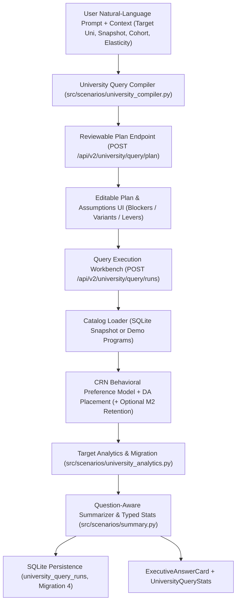

# University Prompt-Driven Simulation & Analytics Report

**Branch:** `university-simulation` (based on `ebed8be` — `Merge branch 'fix/post-merge-alignment'`)  
**Date:** 2026-11-24  
**Scope:** Backend NLP Query Compiler, CRN Behavioral Choice Engine, Analytics & Question-Aware Summarizer, SQLite Registry Integration, `/api/v2/university/query/*` Endpoints, OpenAPI Schema Sync, Frontend `/university` Studio, and Automated Verification.

---

## 1. Executive Summary

This work converts the `/university` simulator from a fixed numeric parameter form into a **prompt-driven, question-answering counterfactual studio** modeled on the repository's `/experiments/new` -> `/results/[id]` workflow, while retaining all Milestone 1 (single-round DA placement) and Milestone 2 (multi-semester financial/retention) numeric controls and contracts.

A user can now type free-form questions in English or Turkish—such as *"How many students would apply to this uni if tuition increased by 30%?"* or *"How would applications and cutoffs change if this uni's ranking got higher or lower?"*—review and edit the compiled assumptions at zero simulation cost, execute a deterministic Common Random Numbers (CRN) simulation against either the built-in catalog or an imported SQLite registry snapshot, and inspect an executive summary paired with dynamically structured statistics (`tiles`, `table`, `bar_series`, `line_series`, `comparison_set`, `flow_summary`, `text_note`).

---

## 2. Core Architectural & Epistemic Principles Enforced

1. **Strict Separation of Concerns**: The compiler (`university_compiler.py`) extracts structured policy specifications; the deterministic engine (`preference_model.py`, `interventions.py`, `engine.py`, `semester_engine.py`, `university_analytics.py`) computes all baseline and policy figures; `summarize_university_query()` narrates only verified computed metrics. Optional live LLM narrative rewriting checks every extracted number against computed outputs via `_llm_numbers_grounded()` and rejects ungrounded rewrites.
2. **Complete Offline Operation**: Deterministic heuristic compilation (`compile_university_query_heuristic`) and deterministic Markdown/structured summarization run with zero network calls or API keys. Live LLM compilation and summary enhancement remain gated behind `SOCIETYTWIN_ENABLE_LIVE_SCENARIO_LLM` and `OPENAI_API_KEY`.
3. **Rivals Stay Fixed**: Interventions target only `target_university_ids`, `target_program_ids`, or `target_department_names` (legacy unscoped behavior remains available when targets are empty). Unselected universities remain static outside options, recorded in `manifest["rivals_fixed"] = True` and surfaced in UI badges and narrative caveats.
4. **Honest Epistemics & Elasticity Ranges**: Behavioral parameters default to uncalibrated synthetic presets (`coefficients_calibrated=False`, `osym_verified=False`). Counterfactual runs execute a Low / Medium / High elasticity sensitivity envelope via `compute_elasticity_sensitivity_range()` instead of presenting a single uncalibrated point forecast as exact.
5. **Common Random Numbers (CRN)**: Candidate taste shocks `epsilon(i, p)` are drawn once per `(candidate_id, program_id, seed)` using `Stream(f"pref:epsilon:{candidate_id}:{program_id}", seed)` and reused across baseline, policy, variant, and elasticity runs.
6. **Non-Conflated Application Definitions**: Every run separately reports `listed_anywhere`, `listed_top_k`, `eligible_applicants`, `first_choice`, and `placed` (plus Milestone 2 retention when requested).

---

## 3. Step Zero Repository Verification & Plan Adaptations

Before modifying code, 10 architectural assumptions were verified against the repository:

| # | Pre-Implementation Claim | Verification Result | Implementation Adaptation |
|---|---|---|---|
| 1 | `experiments/new/page.tsx` compiles prompt, gates on plan review, shows Executive Summary + subgroup results | **True** | Mirrored the compile -> plan review -> run -> executive card pattern inside `/university`. |
| 2 | `university/page.tsx` exposes only numeric inputs and fixed cards | **Mostly True** | Preserved all Milestone 1 & 2 numeric controls under a collapsible `"Customize Parameters"` section (collapsed by default, auto-expanded on `?scenario=` links) with automatic sync from compiled plans. |
| 3 | `compiler.py` detects university prompts and extracts `tuition_change_pct` | **Partially True** | Expanded `detect_domain_and_category()` to match standalone `"uni"`, `"ranking"`, `"rank"`, `"apply"`, `"applications"`, `"cutoff"`, `"cutoffs"`, `"dropout"`, `"retention"`. |
| 4 | `apply_intervention` scales tuition globally without university scoping | **True** (also in M2) | Added `target_university_ids`, `target_program_ids`, `target_department_names` to `apply_intervention` and `program_university_map` scoping to Milestone 2 (`financial_ledger.py`, `semester_engine.py`, `experiments.py`). |
| 5 | Candidate preferences frozen in `cohort_synth.py` prior to intervention | **True** | Kept explicit-preference compatibility in `run_placement()`, activating dynamic utility preferences opt-in via `preference_config`. |
| 6 | No prestige/ranking field on `ProgramOffering` / intervention; `max_rank_override` is baraj gate | **True** | Added `university_rank` and `prestige_score` plus `ranking_change_pct` / `ranking_rank_delta` strictly separated from `max_rank_override`. |
| 7 | `ProgramDelta` lacks applicant counters and summary uses a fixed template | **True** | Extended `ProgramPlacementOutcome` and `ProgramDelta` with `listed_anywhere`, `listed_top_k`, and `dropped_due_to_affordability`; built `university_analytics.py` and `summarize_university_query()`. |
| 8 | SQLite registry (`db.py`, `importer.py`) holds full university/program/tuition history | **Partially True** | `importer.py` leaves `universities.city`, `official_university_code`, and `programs.degree_level` as `NULL`; `annual_admissions` lacks total applicant counts; `annual_tuition` only covers `2025-2026`. Made `ProgramOffering.province_code` nullable (`str | None`) and avoided fabricated empirical calibration. |
| 9 | Placement enforces a preference-list cap (`max_preferences`) | **True** (`24`) | Bounded behavioral list construction in `apply_behavioral_preferences()` by `PlacementRuleset.max_preferences` (default `24`). |
| 10 | CI requires `frontend/openapi.json` and `frontend/src/lib/api/schema.d.ts` sync | **True** | Regenerated both artifacts after adding new `/api/v2` routes. |

---

## 4. End-to-End Architecture

---

## 5. Backend Implementation Breakdown

### 5.1 Query Schema, Intents & Presets — `src/scenarios/university_query.py`
- **`UniversityIntent`** supports 12 distinct query intents:
  `application_demand`, `ranking_sensitivity`, `cutoff_impact`, `placement_fill`, `affordability_equity`, `scholarship_aid`, `quota_capacity`, `revenue_tradeoff`, `retention_impact`, `competitor_flow`, `multi_scenario_compare`, and `composite`.
- **`PreferenceModelConfig` & `preset_preference_config()`**: defines `"low"`, `"medium"`, and `"high"` synthetic elasticity presets calibrated to synthetic income/tuition scales (with `outside_option_threshold` values `0.52`, `0.72`, and `0.92`, and income-stratified `beta_cost_by_income` weights e.g. `{"low": 1.45, "middle": 0.72, "high": 0.42}` for `"medium"`), always flagged `coefficients_calibrated=False`.
- **`UniversityQuerySpec`**: holds parsed `focus_university_id`, `focus_program_ids`, `focus_department_names`, `snapshot_id`, `admission_year`, `levers`, `comparison_variants`, `sweep_tuition_pcts`, `simulation_mode` (`placement` | `retention` | `both`), editable `assumptions`, `unresolved_entities`, and `out_of_scope_reasons`.

### 5.2 NLP University Query Compiler — `src/scenarios/university_compiler.py` & `src/scenarios/compiler.py`
- Updated `detect_domain_and_category()` in [compiler.py](../src/scenarios/compiler.py) so standalone tokens (`"uni"`, `"ranking"`, `"rank"`, `"apply"`, `"applications"`, `"cutoff"`, `"cutoffs"`, `"dropout"`, `"retention"`) route reliably to `university_placement` / `university_policy`.
- Implemented `compile_university_query_heuristic()` (EN/TR/mixed language support):
  - **Entity Resolution (`_resolve_entities`)**: resolves `"this uni"` / `"bu üniversite"` to `context_university_id`, matches explicit university names/IDs cleanly using Turkish diacritic normalization (`_norm()`), detects department aliases and program IDs, and records structured `UnresolvedEntity` blockers with clickable candidates when ambiguous or absent from the catalog.
  - **Out-of-Scope Filtering (`_detect_out_of_scope`)**: blocks unsupported topics (e.g., faculty salaries, dormitories, dining, exchange grants) rather than silently running irrelevant placements.
  - **Need-Based Aid Inference & Fair Comparison**: when `aid_budget_change_pct` is extracted on cohorts whose baseline `need_aid_grant` starts at `0`, infers an explicit `base_aid_budget` assumption (~25% of targeted fee-seat tuition pool, `max_grant_per_student=95_000.0` TL) applied consistently relative to baseline, and keeps `affordability_filter_mode="none"` by default so legacy `eligibility.py` cost-sorting does not override the CRN utility ranking.
  - **Directional Variants & Multi-Scenario Support**: compiles `"higher or lower"` ranking questions into `Lower (-20%)`, `Baseline (0%)`, and `Higher (+20%)` variants (synchronized when edited in the Plan Strip), multi-percentage comparison lists, and revenue tuition sweeps.
- Added gated `compile_university_query_with_llm()` wrapped in `compile_university_query()` with Pydantic validation and catalog-ID enforcement before accepting LLM output.

### 5.3 Targeted Interventions, Exogenous Prestige & M2 Scoping
- **[src/scenarios/schema.py](../src/scenarios/schema.py)**: added `target_university_ids`, `target_program_ids`, `target_department_names`, `ranking_change_pct`, `ranking_rank_delta`, `scholarship_tier_mix`, and `opened_programs` on `UniversityPolicyIntervention`; relaxed `tuition_change_pct` minimum to `-100.0` (allowing free-tuition scenarios).
- **[src/scenarios/placement/interventions.py](../src/scenarios/placement/interventions.py)**:
  - Scoped tuition, capacity, and prestige changes strictly to matching programs (`_program_matches_targets`).
  - `_apply_exogenous_ranking_shift()`: converts percentage shifts (`0.50 * (pct / 100)`) or spot deltas (`clamp(spot_delta / 150.0, -0.45, +0.45)`) into an adjusted `prestige_score` in `[0.02, 0.99]` without touching `max_rank_override` or rival universities.
- **[src/scenarios/university/financial_ledger.py](../src/scenarios/university/financial_ledger.py)**, **[semester_engine.py](../src/scenarios/university/semester_engine.py)**, **[experiments.py](../src/scenarios/university/experiments.py)**: added optional `program_university_map` so multi-semester financial aid/tuition interventions also honor `target_university_ids`, `target_program_ids`, and `target_department_names`.

### 5.4 SQLite Snapshot Catalog Loader — `src/societytwin/university/service.py`
- `list_snapshot_universities()` returns per-university program counts and raw/mapped types (`Devlet -> state`, `Vakıf -> foundation`).
- `load_programs_from_sqlite_snapshot()` constructs `ProgramOffering[]` from SQLite tables (`universities`, `programs`, `annual_admissions`, `annual_tuition`):
  - Derives `tuition_annual` from `full_amount_minor / 100` (computing inferred scholarship % from `net_amount_minor`) or directly from `net_amount_minor / 100` when only net amounts exist (without double-discounting).
  - Maps ÖSYM `annual_admissions.success_rank` on a logarithmic `[0.15, 0.96]` scale (`0.96 - 0.18 * max(0, log10(rank) - 2)`), defaulting missing ranks to `0.22` so unranked offerings do not artificially outrank selective programs.
  - Handles nullable `city` (`province_code=None`), accepts `name-sha256:...` (`max_length=128`) IDs in `ProgramOffering`, and records missing-data counts in metadata.

### 5.5 CRN Behavioral Choice Engine & Sensitivity — `src/scenarios/placement/preference_model.py` & `engine.py`
- `crn_taste_epsilon()` generates a centered triangular deterministic shock in `[-0.45, +0.45]` per `(candidate_id, program_id, seed)`.
- `catalog_fee_scale()` ([models.py](../src/scenarios/placement/models.py)) normalizes synthetic assumed candidate budgets ([cohort_synth.py](../src/scenarios/placement/cohort_synth.py)), utility cost denominators (`cost_unit`), and inferred aid per-student caps relative to the `120,000 TL` Demo baseline (`scale = 1.0` for Demo, `5.33x` for the imported `640,000 TL` median real catalog).
- `score_candidate_program_utility()` computes:
  $$U(i, p) = \beta_{\text{rank}} \cdot \text{rank\_score}(p) - \beta_{\text{cost}}(i) \cdot \frac{\text{net\_tuition}(i,p)}{\text{cost\_unit}} + \beta_{\text{home}} \cdot \mathbb{1}[\text{same province}] + \beta_{\text{fit}} \cdot \text{score\_fit}(i,p) + \text{dept\_aff}(i,p) + \varepsilon(i,p)$$
  anchoring `cost_unit` and ÖSYM reachability matching (`baseline_ranks` when `rank >= 100`) to the pre-intervention baseline catalog, and adding deterministic `crn_department_affinity()` on multi-major catalogs (`len(programs) > 30`) so free programs do not crowd out realistic fee-paying substitution.
- `apply_behavioral_preferences()` sorts remaining options by utility and truncates to `PlacementRuleset.max_preferences` (default `24`).
- `compute_elasticity_sensitivity_range()` runs baseline and policy across `("low", "medium", "high")` presets with identical CRN streams to produce min/central/max applicant bounds.

### 5.6 Analytics & Question-Aware Summarizer — `university_analytics.py` & `summary.py`
- **[src/scenarios/university_analytics.py](../src/scenarios/university_analytics.py)**: computes target-scoped `application_definitions` (separating `listed_anywhere`, `fee_paying_listed`, `listed_top_k`, `eligible_applicants`, `first_choice`, and `placed`), `all_target_programs_free`, `target_capacity`, `target_revenue`, subgroup breakdowns (`income_band`, `province_code`, `province_origin`, `sex`, `score_type_used`), `scholarship_tiers`, per-program deltas, candidate `migration` (`stayed_at_target`, `shifted_within_target`, `shifted_to_rival_uni`, `primary_or_placed_shifted_to_rival`, `dropped_out_of_applying`, `newly_attracted`, `top_rival_destinations`, `top_primary_rival_destinations`), and `cohort_metadata` (`cohort_scale_factor`).
- **[src/scenarios/summary.py](../src/scenarios/summary.py)**: `summarize_university_query()` + `_build_query_sections()` generate intent-adapted headline answers across single runs, multi-scenario comparisons, revenue sweeps, zero-tuition state university notices, mixed 100%-Burslu vs. fee-paying universities, combined placement + retention (`simulation_mode="both"`), Low–High sensitivity ranges, mandatory methodological caveats, Markdown reports, typed `StatisticsSection` payloads, and `_llm_numbers_grounded()` verification if optional LLM prose is enabled.

### 5.7 Persistence & API v2 Endpoints
- **Migration 4 ([src/societytwin/registry/db.py](../src/societytwin/registry/db.py) & [registry.py](../src/societytwin/national/registry.py))**: added `university_query_runs` table (`run_id`, `prompt`, `intent`, `snapshot_id`, `focus_university_id`, `request_hash`, `result_sha256`, `osym_verified`, `coefficients_calibrated`, `query_spec_json`, `request_json`, `result_json`, `summary_json`, `detailed_statistics_json`, `manifest_json`, `created_at`) plus insert/list/get methods.
- **Orchestration & HTTP Routes ([university_service.py](../src/societytwin/national/university_service.py), [service.py](../src/societytwin/national/service.py), [v2.py](../src/societytwin/api/v2.py))**:
  - `POST /api/v2/university/query/plan`
  - `POST /api/v2/university/query/runs` (`201`)
  - `GET /api/v2/university/query/runs`
  - `GET /api/v2/university/query/runs/{run_id}`
  - `GET /api/v2/university-registry/snapshots/{snapshot_id}/universities`

---

## 6. Frontend Integration (`/university`)

- **[frontend/src/lib/api/v2.ts](../frontend/src/lib/api/v2.ts)**: added typed contracts (`UniversityQuerySpec`, `UniversityQueryPlanResponse`, `UniversityQueryRunResponse`, `UniversityQueryRunListItem`, `UniversityQueryStatisticsSection`, `SnapshotUniversityItem`, `PreferenceModelConfig`) and updated `PlacementProgram.province_code` to `string | null`.
- **[frontend/src/components/university/UniversityQueryStudio.tsx](../frontend/src/components/university/UniversityQueryStudio.tsx)**:
  - Prompt hero card with 5 clickable example policy questions.
  - Selectors for **Target University** (`"this uni"`), **Catalog Source** (automatically defaulting to the newest SQLite snapshot when available, or Built-in Demo Catalog otherwise, plus admission year), **Candidate Cohort** (Standalone vs. active TÜİK population + sample size), and **Elasticity Preset** (`low` / `medium` / `high`).
  - Zero-cost **Compile Query Plan** step displaying blockers, clickable candidate suggestions for unresolved university names, editable lever inputs (`tuition_change_pct`, `ranking_change_pct`, `aid_budget_change_pct`, `capacity_change_pct`), assumption provenance badges, comparison variant pills, **Apply to Numeric Controls** sync button, and **Recent University Question Runs** list.
- **[frontend/src/components/university/UniversityQueryStats.tsx](../frontend/src/components/university/UniversityQueryStats.tsx)**:
  - `ExecutiveAnswerCard`: headline, explicit direct answer, key findings, honest epistemic badges (`osym_verified`, `coefficients_calibrated`, `Rivals fixed`, `Source`), caveats box, report copy button, and expandable Markdown view.
  - `UniversityQueryStats`: dynamic renderer across `tiles`, `table`, `bar_series` (via `BarChartCard`), `line_series` (`RetentionTrajectoryChart` or accessible Recharts `LineChart` with table toggle), `comparison_set`, `flow_summary`, and `text_note`.
- **[frontend/src/app/university/page.tsx](../frontend/src/app/university/page.tsx)**: embeds `UniversityQueryStudio` as the primary UI, defaults the legacy Milestone 1 & 2 numeric studio to collapsed (`Customize Parameters`, auto-expanding only for `?scenario=` links), synchronizes compiled levers, and omits the duplicate bottom explorer card already covered by the sidebar navigation.
- **[frontend/src/app/globals.css](../frontend/src/app/globals.css)**: added `.grid-4` with responsive breakpoints so multi-column query/assumption grids render side-by-side cleanly.

---

## 7. Verification & File Inventory

### Automated Test Suites (Run on Final Code)

| Suite / Command | Outcome | Notes |
|---|---|---|
| `.venv\Scripts\python.exe -m pytest -m "not local_fixture and not matraix and not tuik_package" -q` | **941 passed, 5 skipped, 27 deselected** (`102.47s`) | Includes new `test_sqlite_long_sha_keys_and_real_scale_run` and OpenAPI sync check. `5` skipped are environment-gated Windows symlink tests (`test_security.py`, `test_historical_runs.py`), missing disposable real-data bundle tests (`test_persona_selection.py`), and POSIX `fcntl` lock test (`test_worker_lock.py`). |
| `npx tsc --noEmit` & `npx vitest run` (in `frontend/`) | **13 passed test files, 117 passed tests** (`6.87s`) | `tsc --noEmit` exit code `0`; includes `4` `university.test.tsx` tests and `3` `university-query.test.tsx` tests. |
| `npx next build` + client bundle check (in `frontend/`) | **Passed** (`26/26` routes; `48` static JS/CSS files checked) | Zero leaked server environment variables, paths, or key patterns in `.next/static`. |
| `npx playwright test` (all 4 E2E specs against production build + imported `university.sqlite3`) | **30 passed** (`38.1s`) | Covers `historical`, `national` (including `/university?scenario=...`), `narrow`, and `university` (including live `/university` switching from auto-selected SQLite snapshot to Demo Catalog, prompt compilation, run, and stats rendering). |
| OpenAPI + TypeScript schema sync | **Verified** | Regenerated `frontend/openapi.json` and `frontend/src/lib/api/schema.d.ts`; verified by pytest OpenAPI test. |
| Real SQLite snapshot import & counterfactual check (`data/processed/university/university.sqlite3`) | **Imported (`13` unis, `1,282` programs) & 5/5 HTTP 201** | Verified fee-paying substitution (`Ankara Bilim` 5->1, `Başkent` 21->12), `Bilkent` ranking sensitivity (70 -> 100 -> 120 listed), retention (`Başkent` M2), and `ODTÜ` 0-TL state notice. |

### Changed & Added Files (`university-simulation`)

#### Modified (`25` files)
- `.gitignore`
- `frontend/e2e/university.spec.ts`
- `frontend/openapi.json`
- `frontend/src/app/globals.css`
- `frontend/src/app/university/page.tsx`
- `frontend/src/lib/api/schema.d.ts`
- `frontend/src/lib/api/v2.ts`
- `frontend/src/test/university.test.tsx`
- `src/scenarios/compiler.py`
- `src/scenarios/placement/cohort_synth.py`
- `src/scenarios/placement/comparison.py`
- `src/scenarios/placement/engine.py`
- `src/scenarios/placement/interventions.py`
- `src/scenarios/placement/models.py`
- `src/scenarios/schema.py`
- `src/scenarios/summary.py`
- `src/scenarios/university/experiments.py`
- `src/scenarios/university/financial_ledger.py`
- `src/scenarios/university/semester_engine.py`
- `src/societytwin/api/v2.py`
- `src/societytwin/national/registry.py`
- `src/societytwin/national/service.py`
- `src/societytwin/national/university_service.py`
- `src/societytwin/registry/db.py`
- `src/societytwin/university/service.py`

#### New (`14` files)
- `data/raw/university/Universite_Bolum_Kontenjan_Yerlesen_Sira_Burs_Ucret.xlsx`
- `data/processed/university/university.sqlite3`
- `data/processed/university/import-report.json`
- `src/scenarios/university_query.py`
- `src/scenarios/university_compiler.py`
- `src/scenarios/placement/preference_model.py`
- `src/scenarios/university_analytics.py`
- `frontend/src/components/university/UniversityQueryStudio.tsx`
- `frontend/src/components/university/UniversityQueryStats.tsx`
- `tests/test_scenarios/test_university_query_compiler.py`
- `tests/test_scenarios/test_university_preference_and_summary.py`
- `tests/national/test_university_query_api.py`
- `frontend/src/test/university-query.test.tsx`
- `docs/university-prompt-query-report.md` (this report)

---

## 8. Constraints & Operational Notes

- **Hypothetical Calibration Status**: All simulations currently operate with `osym_verified=False` and `coefficients_calibrated=False`; synthetic demand responses depend heavily on assumed price/prestige sensitivities and should be read using the reported Low–High range rather than as empirically calibrated point forecasts.
- **SQLite Registry Data & Git Ignore Exceptions**: Imported workbook `Universite_Bolum_Kontenjan_Yerlesen_Sira_Burs_Ucret.xlsx` (`sha256:03c4ac42...`) into `data/processed/university/university.sqlite3` (`13` universities, `1,282` programs across `2019–2026`). `.gitignore` adds negation rules (`!data/raw/university/**`, `!data/processed/university/**`, `!*.xlsx`, `!data/**/*.xlsx`, `!university.sqlite3`) so source workbooks and `university.sqlite3` remain trackable.
- **Git State**: Committed and pushed to branch `university-simulation`.
